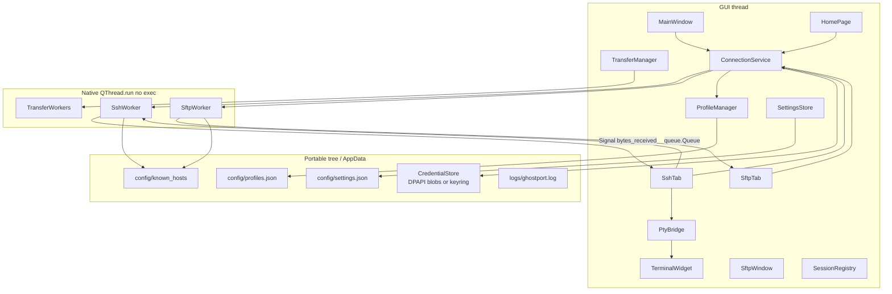
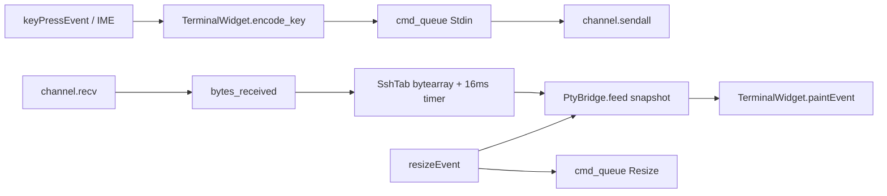
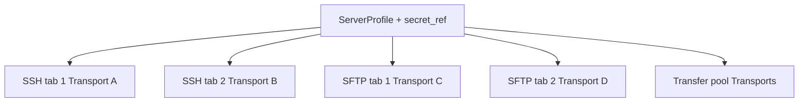

# Ghostport — Architecture & V1 Design

> Paths in this document are from the original V1 layout. The original brief now lives at [`docs/original-brief.txt`](original-brief.txt).

| Field | Value |
| --- | --- |
| **Title** | Ghostport Windows Portable SSH + SFTP Client |
| **Author** | Ghostport maintainers |
| **Date** | 2026-09-16 |
| **Status** | Draft (revised) |
| **Audience** | Senior engineers implementing V1 |
| **Python** | 3.10+ (workspace: 3.10.0) |
| **V1 scope** | `req.txt` Priority 1–3; Stages 1–7 |

---

## Overview

Ghostport is a portable, user-space Windows desktop client that replaces the Xshell + Xftp workflow for ~10–15 personal Linux/VPS servers. SSH is the primary experience: a dark, tabbed terminal whose saved **server profiles** make connecting one click. SFTP is a tightly linked second window: **Open SFTP** from an SSH tab or home card opens a two-pane explorer for that same profile **without a login dialog**.

The stack is **Python 3.10 + PySide6 + Paramiko + pyte**, packaged as a **PyInstaller onedir** tree that runs without admin, Program Files, or HKLM writes. Secrets never sit in JSON; they live in Windows Credential Locker (installed mode) or DPAPI-encrypted blobs next to the exe (portable mode, the default). Each SSH tab and each SFTP tab owns an independent Paramiko `Transport`. Credential reuse — not channel multiplexing — is the V1 mechanism that makes “Open SFTP, no password prompt” true.

This document is the implementation contract for V1. Module names, JSON schemas, thread boundaries, and the seven-stage PR plan are specified so Stage 1 can start without inventing them.

---

## Background & Motivation

The author uses Xshell 8 + Xftp on a work laptop **without administrator rights**. Those apps need IT-approved updates and typical installers. The actual daily workflow is small:

1. Open the client, see 10–15 favorites.
2. Double-click `QA_SERVER` → interactive SSH (vim, htop, docker, journalctl).
3. Right-click the tab → **Open SFTP** → upload/download without re-typing the password.

Pain points of the current tools, and of a naive Python “toy” client:

- Installers and auto-updaters require elevation.
- Passwords in `servers.json` are unacceptable.
- `QPlainTextEdit` is not a terminal: vim/htop/less break.
- Asking for credentials again when opening SFTP destroys the reason to build this.
- Mixing asyncio with Paramiko’s blocking I/O and the Qt loop is a known footgun.

Ghostport exists to be a **small personal tool** with a strong foundation: real PTY, real SFTP, portable layout, Windows-native secret storage, and a dark professional UI. Advanced features (forwarding, jump hosts, plugins) are explicitly deferred.

---

## Goals & Non-Goals

### Goals (V1)

- Portable Windows app; no admin, no service, no Program Files, no HKLM.
- Saved server profiles with UUID primary keys; favorites + search on a pinned Home tab.
- Password, private-key (OpenSSH / PEM, optional passphrase), and SSH-agent auth.
- Secrets out of JSON: `keyring` (Credential Locker) or DPAPI blobs in `config/`.
- Multi-tab SSH with a real VT/xterm-ish emulator (pyte + cell-grid `TerminalWidget`).
- Independent SSH sessions per tab; duplicate tab = new TCP connection.
- Separate SFTP window, two-pane explorer, tabs, transfer queue, context menus, DnD if practical.
- **Open SFTP never prompts for credentials**; it uses `ServerProfile` + `CredentialStore`.
- TOFU host-key verification; never silently accept; never disable verification by default.
- Dark QSS default; Light + System; monospaced terminal font.
- Structured connection errors with [Retry] [Edit Server].
- Rotating logs with secret redaction.
- pytest for non-GUI core; PyInstaller onedir + `scripts/build_windows.ps1`.

### Non-Goals (explicitly out of V1)

Port forwarding, SOCKS, jump hosts / ProxyJump, cloud sync, team sharing, accounts, plugins, telemetry, auto-update, RDP, terminal recording, scripting engines, master-password vault, Transport-level SSH/SFTP multiplexing, truecolor `xterm-direct`, installer/MSI, code signing.

---

## Technical Ambiguities Resolved

Requirements (`req.txt`) left several gaps. None are punted. Each row is the decision an implementer must follow.

| Ambiguity in requirements | Decision |
| --- | --- |
| PyQt6 vs PySide6; license for portable redistribution | **PySide6 (LGPL)**. Personal onedir redistribution is simpler than GPL PyQt6. See Key Decision 1. |
| Which terminal emulator; “don’t use a simple QTextEdit” | **pyte** parses VT; custom `TerminalWidget` paints a cell grid. Do not parse ANSI ourselves; do not use QTextEdit/QPlainTextEdit as the terminal. |
| asyncio “where appropriate” vs QThread | **QThread as a native thread + `queue.Queue` commands + Qt signals worker→GUI.** No asyncio. No `QThread.exec()` for the life of a PTY/SFTP/transfer. Paramiko is blocking. |
| “If the existing SSH connection can safely be reused for SFTP, reuse it” | V1 = **credential reuse**, not `transport.open_sftp_client()`. Independent Transports so SSH close/reconnect does not kill SFTP. Multiplexing is a documented future optimization. |
| Portable vs `%APPDATA%`; when each applies | **Portable iff** `portable.flag` exists next to the exe/source dir **or** `config/` exists **and** contains `profiles.json` or `settings.json`. Else `%APPDATA%\Ghostport`. **Then** mkdir. Empty mkdir’d `config/` is not a user-data signal. Packaged builds always ship `portable.flag`. Forcing AppData requires deleting **both** the flag **and** `config/`. |
| Where passwords/passphrases live; roaming USB | **DPAPI blobs in `config/secrets/`** (portable) or **Credential Locker via `keyring`** (appdata mode). DPAPI is per-Windows-user-on-this-machine; a USB copy does **not** unlock on another PC or another Windows user. No master password in V1. |
| Host key verification (omitted entirely) | **TOFU** via `Transport.start_client` → `get_remote_server_key` → `KnownHostsStore`. Unknown → [Abort] [Trust and Continue]. Mismatch → block, OpenSSH `SHA256:` fingerprints, MITM warning, [Abort] [Replace and Continue]. Never auto-accept. Hostnames stored as `[host]:port` for **all** ports including 22. One in-flight prompt per `(host,port)`. Dialog reject = ABORT; no prompt timeout. |
| Ctrl+T/W/C vs vim/nano/htop | Terminal focused: raw keys including Ctrl+C/Z/D/W/T/F go to the PTY. Chrome uses **Ctrl+Shift+** variants. Non-terminal surfaces honor Ctrl+T/W/F. |
| Ctrl+T “new SSH tab” — which profile? | Home with a selected card: connect that profile. Home with no selection: focus search. SSH tab focused: **Ctrl+Shift+T** duplicates that profile (new Transport). Do not invent a quick-connect dialog in V1. |
| Home screen vs tab bar | Pinned unclosable **Home** tab at index 0. `+` focuses Home. Double-click / [SSH] opens a new SSH tab. |
| One SFTP window vs many | One **primary** `SftpWindow`. **Open SFTP** focuses the first existing tab for that `profile_id`, else creates one (new Transport). **Duplicate Tab** and **Open SFTP in New Window** always create a new tab/window (new Transport). Extra windows share the process-global `TransferManager` queue. |
| “Open” remote file | Download to `%TEMP%\Ghostport\` (or portable temp) → `QDesktopServices.openUrl`. |
| “Open terminal here” | If a connected SSH tab exists for that profile, focus it and send `cd {shlex.quote(path)}\r`; else new SSH tab with `initial_directory` (same `cd …\r` after CONNECTED). |
| Transport sharing vs independent lifetime | Independent Paramiko `Transport` per SSH tab and per SFTP tab. Closing one never tears down another. |
| Private keys: copy into `keys/`? | Store **paths** only. Copy into `keys/` only on explicit user Import. Passphrases in the vault. |
| SSH agent backend | Ordered: connect `\\.\pipe\openssh-ssh-agent` first (do not rely on `paramiko.Agent()` default, which is Pageant-first on Windows), then Pageant (`paramiko.win_pageant`). Then `AuthenticationFailed`. Agent mode stores no secret. |
| Light theme completeness | Full `light.qss`, not a stub. System theme reads `AppsUseLightTheme`. |
| Config format | JSON: `profiles.json`, `settings.json`. Profile PK = UUID. |
| Transfer concurrency | Sequential-per-connection is the default *scheduling unit*; configurable worker count **default 3**. Overwrite confirm **before** enqueue. |
| Packaging onefile vs onedir | **onedir**. Faster start, easier missing-DLL debug. No installer. |
| Stage 6 (credentials) vs Stage 1 (Add Server) | **PR1 introduces the vault** (`CredentialStore`, DPAPI/keyring) because Add Server must persist secrets. **req.txt Stage 6 becomes PR6 hardening** (redaction/TOFU/audit after PR2–PR5 exist). PR6 depends on PR5. |
| Mouse in terminal (“where supported”) | V1: local selection, wheel, context menu. xterm mouse-tracking (1000/1002/1006) is best-effort; htop keyboard is the supported path. |
| Tab rename vs profile rename | **Rename Tab** is session-local (`SshTab.title_override`). Profile rename is Edit Server and updates Home + future tabs. |
| Default local SFTP directory | Local `QFileSystemModel` is rooted at My Computer (all drive letters), **not** `C:\` only. Starting cwd navigates to `sftp.default_local_directory` if set, else Windows Downloads if present, else user home. |
| Encoding | UTF-8. Display decode uses `errors="replace"`. Keystrokes/paste encoded UTF-8. |

---

## Key Decisions

1. **Qt binding = PySide6 (LGPL), not PyQt6 (GPL).** Portable personal redistribution of a frozen exe is legally simpler under LGPL. APIs are close enough that a later swap is possible; we will not dual-bind. Import: `from PySide6 import QtCore, QtGui, QtWidgets`.

2. **SSH/SFTP library = Paramiko.** Do not implement the protocols. Use **`paramiko.Transport` directly** (not `SSHClient`) so host-key TOFU runs after `start_client` / `get_remote_server_key` and **before** auth. SSH: `open_session` + `get_pty` + `invoke_shell`. SFTP: `paramiko.SFTPClient.from_transport`. Pin `paramiko>=3.4,<4`. All Transports are created by worker-only `open_authenticated_transport(profile_id)`.

3. **Terminal = pyte + `TerminalWidget` (QWidget cell grid).** `QTextEdit`/`QPlainTextEdit` cannot do vim/htop correctly. pyte owns ANSI/VT parsing (`pyte.Stream` + `pyte.HistoryScreen`) on the GUI thread inside `PtyBridge`. `PtyBridge.feed` copies dirty rows into an immutable snapshot; `TerminalWidget` paints that snapshot only. Key encoding lives on `TerminalWidget` (QtGui), not in `ssh/`. Known gaps (truecolor, some mouse/alt-screen edge cases) are mitigated by `TERM=xterm-256color`, `wcwidth`, and an explicit interactive test matrix (vim, nano, less, htop, top, `docker exec`, ipython).

4. **Event model = native worker loops on `QThread.run()` (no `exec()`), `queue.Queue` GUI→worker, Qt signals worker→GUI.** No asyncio in V1. A blocking `channel.recv` / SFTP `listdir` / `get`/`put` never shares a thread with `QThread.exec()`, so stdin/resize/cancel cannot be Qt slots on that thread. GUI enqueues commands; the worker drains the queue on `socket.timeout` and after each recv/op. Worker→GUI stays `Signal` with `Qt.QueuedConnection`. Do not call `thread.quit()` (there is no `exec()`). `finished` fires when `run()` returns after the native loop exits.

5. **SSH ↔ SFTP = credential reuse, not Transport multiplexing.** Each SSH tab = one Transport + one session/PTY channel (Xshell-like: duplicate tab = new TCP connection). Open SFTP = a **new** Transport authenticated from the same `ServerProfile` + `CredentialStore` secret. Explorer tabs do **not** share Transports with the transfer pool. UI never holds passwords. `ConnectionService` is the GUI factory; workers call `open_authenticated_transport`. `transport.open_sftp_client()` on an SSH Transport is a future optimization (Risk: coupling lifetimes when SSH reconnects).

6. **Credential storage = `keyring` (normal) + DPAPI (portable default).** Never plaintext JSON. Profile JSON stores `secret_ref` IDs only. Private key **paths** stay in the profile; passphrases and passwords go in the vault. Agent mode stores nothing. DPAPI (`CryptProtectData` / `CryptUnprotectData` via ctypes — no pywin32) is per-user-on-this-machine; portable USB copies do not roam secrets. No master-password scheme in V1.

7. **Paths = portable-first, algorithm frozen.** (1) Locate install/source dir (`sys.executable` parent if frozen, else repo root). (2) Portable **iff** `portable.flag` exists **or** (`config/` exists **and** contains `profiles.json` or `settings.json`). (3) Else `%APPDATA%\Ghostport`. (4) **Then** mkdir `config/`, `logs/`, `keys/`, `config/secrets/`. Packaged builds always ship `portable.flag`. Deleting the flag **and** `config/` is required to force AppData. An empty mkdir’d `config/` is not a user-data signal. Layout:

   ```
   Ghostport/
     Ghostport.exe
     portable.flag
     config/     profiles.json  settings.json  known_hosts  secrets/*.dpapi
     logs/       ghostport.log
     keys/       optional user-imported keys (not default)
   ```

8. **Host keys = TOFU** via Paramiko `HostKeys` in OpenSSH `known_hosts` format, hostname key **`[host]:port` for every port including 22**. Fingerprints are OpenSSH `SHA256:` + unpadded base64 of SHA-256(`key.asbytes()`). Unknown: [Abort] [Trust and Continue]. Mismatch: block, show stored vs seen type+fingerprint, MITM warning, [Abort] [Replace and Continue]. Never auto-accept; no “accept all”. One in-flight prompt per `(host,port)` coalesced. Dialog reject = ABORT. File writes take a process-wide `known_hosts` lock.

9. **Shortcuts vs PTY.** Terminal focused → PTY gets Ctrl+C/Z/D/W/T/F (and everything else except the Ctrl+Shift chrome set). Implementers must not bind Ctrl+C as Copy when the terminal has focus. Copy/paste in terminal: Ctrl+Shift+C / Ctrl+Shift+V (also Ctrl+Insert / Shift+Insert). See [Keyboard Shortcuts](#keyboard-shortcuts).

10. **Home is a pinned tab**, not a separate window. Unclosable, leftmost. `+` on the tab bar focuses Home. Double-click favorite or [SSH] opens a new SSH tab. [SFTP] is Open SFTP on the primary window (focus-or-create).

11. **SFTP window policy.** One primary `SftpWindow`. **Open SFTP** focuses the first existing tab for that `profile_id`, else creates one. **Duplicate Tab** and **Open SFTP in New Window** always create. Each SFTP tab = independent explorer Transport from the same credential source. Extra `SftpWindow`s share the process-global `TransferManager` and its queue view.

12. **Open remote file / Open terminal here.** File: download to temp (`paths.temp_dir`) then `QDesktopServices.openUrl`. Terminal: reuse a connected SSH tab for that `profile_id` if one exists (`SessionRegistry.find_connected_ssh`); else `ConnectionService.start_ssh(..., initial_directory=path)`. In both cases the bytes sent are `cd {shlex.quote(path)}\r`.

13. **Transfer queue.** One process-global `TransferManager` (GUI thread coordinator); `TransferWorker` native loops; configurable concurrency (settings, default 3). Explorer tab ≠ transfer pool. Progress, speed, ETA. Cancel sets a `threading.Event`; the worker sees it on the get/put callback and **drops that job’s pool connection**. Retry deletes the partial then re-enqueues. Overwrite confirmation **before** enqueue via `stat_ready`. Extra SFTP windows share the same queue view.

14. **Config = JSON**; profile primary key = **UUID** (`id`), not name. Rename-safe. Atomic writes (temp file + `os.replace`).

15. **Python 3.10+**, type hints throughout (`from __future__ import annotations` in every module). `dataclasses` / `Enum` for models. `pathlib.Path`. No `except: pass`. No `except Exception: pass`.

16. **V1 scope = Priority 1–3 in `req.txt`.** See Non-Goals.

17. **Packaging = PyInstaller onedir**, `scripts/build_windows.ps1`, `ghostport.spec`. No installer, no HKLM, no Program Files. The dist folder *is* the portable app.

18. **Theming.** Dark QSS default (charcoal, subtle borders, one restrained teal accent — not neon). Light + System in settings. System follows `AppsUseLightTheme`. **Qt Style Sheets do not support CSS custom properties, and `str.format_map` is forbidden** (QSS `{ }` blocks would collide). Stage 1 rule: `string.Template` with `$bg` / `${bg}` (QSS does not use `$`). Terminal font: Cascadia Mono, then Consolas, then `QFontDatabase.systemFont(FixedFont)`.

19. **Logging.** stdlib `logging` to `logs/ghostport.log`, `RotatingFileHandler` 2 MB × 5 files + stderr during dev. Redact secrets (passwords, passphrases, key material, `secret_ref` values in debug dumps). Levels: connection attempt/success/fail, SFTP fail, uncaught errors.

20. **Error UX.** `GhostportError` subclasses carry `profile_name`, `host`, `port`, `reason`. Dialogs: [Retry] [Edit Server]. Never a bare “Connection failed”.

21. **Tests.** pytest for `ProfileManager`, `CredentialStore` (fake backend), `KnownHostsStore`, `TransferJob` state machine. GUI tests not required in V1.

22. **Package layout** is the tree in [Proposed Design](#package-layout). Entry: `ghostport/main.py` and `python -m ghostport`. Factory: `ghostport/services/connection_service.py`. Worker transport: `ghostport/ssh/transport.py` (`open_authenticated_transport`). Terminal: `pty_bridge.py` (no QtGui) + `terminal_widget.py`. Session registry: `ghostport/ui/session_registry.py`. Paths: `ghostport/config/paths.py`.

23. **Threading** is specified in [Threading Architecture](#threading-architecture): native loops, command queues, credit-based `bytes_received` backpressure, resize, keepalive, teardown.

24. **Data model** is the JSON schema in [Data Model Changes](#data-model-changes). `auth_method`: `password` | `private_key` | `agent`. Fields include `secret_ref`, `keep_alive`, `timeout_sec` (socket connect + banner; auth uses the same budget via `transport.auth_timeout`), `term_type`, `initial_directory`, `favorite`, `sort_index`. `Settings` is a dataclass including `appearance.dont_show_portable_secret_warning`.

25. **Stages = req.txt §36**, mapped onto the PR Plan. **PR1 introduces the vault**; req.txt Stage 6 is **PR6 hardening** and depends on PR5. Every stage leaves the app runnable. PR1 `GhostportApp` has `paths/settings/profiles/credentials` only; [SSH]/[SFTP] are disabled with tooltips until PR2/PR4.

26. **Risks** (pyte vs vim/htop, Paramiko perf, DPAPI non-roaming, PyInstaller AV, PTY resize races, no-admin APIs) are in [Risks](#risks) with severity and mitigation. Credential Manager and DPAPI **do not need admin**.

---

## Proposed Design

### High-level architecture



Layers (this is the binding contract; the class catalog matches it):

| Layer | Responsibility | May import |
| --- | --- | --- |
| `ghostport.ui.*` | Widgets, dialogs, QSS, shortcuts, `SessionRegistry` | services, profiles, config, errors, **and** `ssh`/`sftp` **session, bridge, file-model, and job types only** (not `SshWorker` / `SftpWorker` / `open_authenticated_transport`) |
| `ghostport.services.*` | `ConnectionService` factory | ssh, sftp, security, profiles, config, errors — **not** `ui` |
| `ghostport.ssh.*` / `ghostport.sftp.*` | Paramiko workers, pyte bridge, transfers | security, config, errors, profiles, **QtCore only** (`QObject`/`Signal` for worker signal objects) — **not** `ui`, **not** `QtGui`/`QtWidgets` |
| `ghostport.profiles.*` / `ghostport.config.*` / `ghostport.security.*` | Persistence, paths, vault | stdlib + keyring/ctypes |
| `ghostport.resources.*` | Icons, QSS templates (loaded via `importlib.resources` or frozen `_MEIPASS`) | nothing |

**UI never holds passwords, passphrases, or `PKey` objects.** Widgets pass `profile_id` into `ConnectionService`. Secrets load on the worker via `open_authenticated_transport`. Widgets never connect to `SshWorker` — `SshSession` forwards `bytes_received` / `state_changed` / `error_occurred`. **`MainWindow` is the sole GUI owner of `host_key_decision_needed`** (shows `HostKeyDialog`, then `provide_host_key_decision`). `SftpWindow` must not connect that signal. `encode_key` lives on `TerminalWidget` (`QKeyEvent` stays in `ui/`).

### Package layout

```
Ghostport/                          # repo root (dev) and onedir root (dist)
├── ARCHITECTURE.md
├── req.txt
├── README.md                       # Stage 7: run/build notes (not this task)
├── requirements.txt
├── requirements-dev.txt
├── ghostport.spec                  # Stage 7
├── portable.flag                   # present in repo + dist so dev matches portable
├── scripts/
│   └── build_windows.ps1
├── tests/
│   ├── conftest.py
│   ├── test_paths.py
│   ├── test_profiles.py
│   ├── test_credentials.py
│   ├── test_known_hosts.py
│   └── test_transfer_job.py
├── config/                         # created at runtime if missing
├── logs/
├── keys/
└── ghostport/
    ├── __init__.py                 # __version__ = "0.1.0"
    ├── __main__.py                 # python -m ghostport
    ├── main.py                     # def main() -> int
    ├── app.py                      # class GhostportApp(QApplication)
    ├── errors.py                   # GhostportError hierarchy
    ├── logging_setup.py
    ├── constants.py                # APP_NAME, KEYRING_SERVICE, TERM default
    ├── config/
    │   ├── __init__.py
    │   ├── paths.py                # AppPaths: portable vs appdata
    │   └── settings.py             # Settings dataclass + SettingsStore
    ├── profiles/
    │   ├── __init__.py
    │   ├── models.py               # AuthMethod, ServerProfile
    │   └── manager.py              # ProfileManager
    ├── security/
    │   ├── __init__.py
    │   ├── credentials.py          # CredentialStore + backends
    │   └── dpapi.py                # protect/unprotect via ctypes
    ├── services/
    │   ├── __init__.py
    │   └── connection_service.py   # SSH/SFTP factory; host-key coalescing
    ├── ssh/
    │   ├── __init__.py
    │   ├── transport.py            # open_authenticated_transport (worker-only)
    │   ├── connection.py           # SshWorker native loop + command queue
    │   ├── session.py              # SshSession (GUI-side facade)
    │   ├── pty_bridge.py           # pyte screen + dirty-row snapshot (no QtGui)
    │   ├── known_hosts.py          # HostKeyPrompt, KnownHostsStore, TOFU
    │   ├── agent.py                # OpenSSH named pipe then Pageant
    │   └── keepalive.py            # interval helper (Transport.set_keepalive)
    ├── sftp/
    │   ├── __init__.py
    │   ├── connection.py           # SftpWorker
    │   ├── session.py              # SftpSession
    │   ├── file_model.py           # RemoteFileModel, FileEntry
    │   └── transfer_manager.py     # TransferManager, TransferJob, TransferWorker
    ├── ui/
    │   ├── __init__.py
    │   ├── main_window.py          # MainWindow
    │   ├── home_page.py            # HomePage
    │   ├── session_registry.py     # open tabs/windows (UI layer)
    │   ├── ssh_tab.py              # SshTab (PR2+)
    │   ├── sftp_window.py          # SftpWindow (stub PR3, real PR4)
    │   ├── sftp_tab.py             # SftpTab (PR4+)
    │   ├── server_dialog.py        # ServerDialog (add/edit)
    │   ├── settings_dialog.py      # SettingsDialog
    │   ├── host_key_dialog.py      # unknown / mismatch (PR2+)
    │   ├── connection_error_dialog.py
    │   ├── shortcuts.py            # install_shortcuts(window)
    │   ├── theme.py                # string.Template $bg QSS, system light/dark
    │   └── widgets/
    │       ├── __init__.py
    │       ├── terminal_widget.py  # TerminalWidget
    │       ├── server_card.py      # ServerCard
    │       ├── status_dot.py       # StatusDot
    │       ├── file_pane.py        # FilePane (local/remote)
    │       ├── path_bar.py         # PathBar
    │       └── transfer_queue_view.py
    └── resources/
        ├── icons/
        │   ├── app.ico
        │   └── app.svg             # simple ghost/port mark
        └── styles/
            ├── dark.qss
            └── light.qss
```

### Module and class catalog

Concrete names. Do not invent parallel types.

#### Entry and app

```python
# ghostport/main.py
def main(argv: list[str] | None = None) -> int:
    argv = list(sys.argv if argv is None else argv)
    app = GhostportApp(argv)                 # 1. QApplication exists first (Windows)
    app.paths = AppPaths.resolve()           # 2. portable vs AppData; no mkdir yet
    app.paths.ensure_dirs()                  # 3. THEN mkdir config/logs/keys/secrets
    configure_logging(app.paths)             # 4. needs logs_dir
    app.settings = SettingsStore(app.paths)  # 5. stores
    app.settings.load()
    app.credentials = CredentialStore.for_paths(app.paths)
    app.profiles = ProfileManager(app.paths)
    app.profiles.load()
    apply_theme(app, app.settings.get())     # 6. string.Template $bg / ${bg}
    window = MainWindow(app)
    window.show()
    return app.exec()

# ghostport/app.py
class GhostportApp(QApplication):
    """PR1 attributes only. ConnectionService is attached in PR2; TransferManager in PR5."""
    paths: AppPaths
    settings: SettingsStore
    profiles: ProfileManager
    credentials: CredentialStore
    # PR2: connections: ConnectionService
    # PR5: transfers: TransferManager   # process-global
```

`SessionRegistry` is **not** on `GhostportApp`. It lives on `MainWindow` (`ghostport/ui/session_registry.py`) starting PR3.

#### Config

```python
# ghostport/config/paths.py
@dataclass(frozen=True)
class AppPaths:
    root: Path              # portable root or %APPDATA%\Ghostport
    config_dir: Path
    logs_dir: Path
    keys_dir: Path
    secrets_dir: Path       # config/secrets
    profiles_file: Path     # config/profiles.json
    settings_file: Path     # config/settings.json
    known_hosts_file: Path  # config/known_hosts
    temp_dir: Path          # %TEMP%\Ghostport or root/tmp
    is_portable: bool

    @staticmethod
    def resolve(exe_or_source_dir: Path | None = None) -> AppPaths: ...
    def ensure_dirs(self) -> None: ...   # mkdir AFTER resolve, never before

# AppPaths.resolve — frozen algorithm:
# 1. install_dir = exe_or_source_dir
#    or (Path(sys.executable).resolve().parent if getattr(sys, "frozen", False)
#        else Path(__file__).resolve().parents[2])  # repo root
# 2. is_portable = (install_dir / "portable.flag").is_file() or (
#        (install_dir / "config").is_dir()
#        and ((install_dir / "config" / "profiles.json").is_file()
#             or (install_dir / "config" / "settings.json").is_file())
#    )
#    Empty config/ created by a previous mkdir does NOT count.
# 3. root = install_dir if is_portable else Path(os.environ["APPDATA"]) / "Ghostport"
# 4. Caller then root-relative paths; ensure_dirs() mkdirs.
```

Dev-from-source: the repo ships `portable.flag`, so developers exercise the same layout the packaged user will. Packaged builds always copy `portable.flag` into `dist/Ghostport/`. To force AppData, delete **both** `portable.flag` **and** the `config/` directory (a leftover `config/profiles.json` still forces portable). Not a V1 UI toggle.

```python
# ghostport/config/settings.py
@dataclass
class AppearanceSettings:
    theme: str = "dark"  # dark | light | system
    dont_show_portable_secret_warning: bool = False

@dataclass
class TerminalSettings:
    font_family: str = ""
    font_size: int = 11
    cursor_style: str = "block"  # block | bar | underline
    scrollback_lines: int = 5000
    copy_on_select: bool = False
    paste_warning_threshold: int = 2000
    term_type: str = "xterm-256color"

@dataclass
class ConnectionSettings:
    timeout_sec: int = 10
    keep_alive_interval_sec: int = 30
    reconnect_on_tab_focus: bool = False

@dataclass
class SftpSettings:
    default_local_directory: str = ""
    show_hidden_files: bool = False
    confirm_deletes: bool = True
    confirm_overwrites: bool = True
    transfer_concurrency: int = 3

@dataclass
class Settings:
    version: int = 1
    appearance: AppearanceSettings = field(default_factory=AppearanceSettings)
    terminal: TerminalSettings = field(default_factory=TerminalSettings)
    connections: ConnectionSettings = field(default_factory=ConnectionSettings)
    sftp: SftpSettings = field(default_factory=SftpSettings)

class SettingsStore:
    def load(self) -> Settings: ...
    def get(self) -> Settings: ...
    def save(self, settings: Settings) -> None: ...
    def update(self, **kwargs: Any) -> Settings: ...
```

#### Profiles

```python
# ghostport/profiles/models.py
class AuthMethod(str, Enum):
    PASSWORD = "password"
    PRIVATE_KEY = "private_key"
    AGENT = "agent"

@dataclass
class ServerProfile:
    id: str                          # uuid4
    name: str
    host: str
    port: int = 22
    username: str = ""
    description: str = ""
    auth_method: AuthMethod = AuthMethod.PASSWORD
    private_key_path: str | None = None   # filesystem path, never key bytes
    secret_ref: str | None = None         # vault id; None for agent
    favorite: bool = True
    sort_index: int = 0
    keep_alive: bool = True
    keep_alive_interval_sec: int = 30
    timeout_sec: int = 10
    term_type: str = "xterm-256color"
    initial_directory: str = ""
    created_at: str = ""             # ISO-8601
    updated_at: str = ""

# ghostport/profiles/manager.py
class ProfileManager:
    def __init__(self, paths: AppPaths) -> None: ...
    def load(self) -> None: ...
    def all(self) -> list[ServerProfile]: ...
    def favorites(self) -> list[ServerProfile]: ...   # favorite=True, sort_index
    def get(self, profile_id: str) -> ServerProfile: ...
    def upsert(self, profile: ServerProfile) -> ServerProfile: ...
    def delete(self, profile_id: str) -> None: ...    # JSON only; does NOT touch the vault
    def reorder(self, ordered_ids: list[str]) -> None: ...
    def search(self, query: str) -> list[ServerProfile]: ...  # case-insensitive name/host/user
```

Atomic save: write `profiles.json.tmp` then `os.replace`. Keep a `profiles.json.bak` of the previous good file.

`ProfileManager` does **not** take a `CredentialStore`. Vault mint/overwrite/clone/delete happens in the **UI controller** (`HomePage` / `MainWindow` around `ServerDialog.accept`, Duplicate, Delete). See [Credential write path](#credential-write-path).

#### Security

```python
# ghostport/security/dpapi.py
def protect(plaintext: bytes) -> bytes: ...   # CryptProtectData, CRYPTPROTECT_UI_FORBIDDEN
def unprotect(blob: bytes) -> bytes: ...      # CryptUnprotectData

# ghostport/security/credentials.py
class CredentialBackend(Protocol):
    def get(self, secret_ref: str) -> str | None: ...
    def set(self, secret_ref: str, secret: str) -> None: ...
    def delete(self, secret_ref: str) -> None: ...

class DpapiFileBackend:
    """config/secrets/<secret_ref>.dpapi — portable default."""

class KeyringBackend:
    """Windows Credential Locker via keyring. service=Ghostport, username=secret_ref."""

class MemoryBackend:
    """Tests only. Never used in production."""

class CredentialStore:
    def __init__(self, backend: CredentialBackend) -> None: ...
    def put_secret(self, secret: str, *, secret_ref: str | None = None) -> str:
        """Overwrite `secret_ref` if given; else mint `gp-<uuid4>` and write.
        `put_password` / `put_passphrase` are aliases of this (same vault)."""
    def put_password(self, secret: str, *, secret_ref: str | None = None) -> str: ...
    def put_passphrase(self, secret: str, *, secret_ref: str | None = None) -> str: ...
    def get_secret(self, secret_ref: str) -> str | None: ...
    def delete(self, secret_ref: str) -> None: ...
    @staticmethod
    def new_ref() -> str: ...   # "gp-" + uuid4
```

Factory: `CredentialStore.for_paths(paths: AppPaths) -> CredentialStore` → DPAPI if `paths.is_portable` else keyring.

`CRYPTPROTECT_UI_FORBIDDEN` (0x1) prevents DPAPI from showing a prompt — required because we run on a worker thread and this is a no-admin portable app.

**Write rules (enforced by the UI controller, not `ProfileManager`):**

| Action | Vault | `secret_ref` on profile |
| --- | --- | --- |
| Create, `auth_method=password` | Reject Save if password empty. Mint ref, `put_secret`. | new ref |
| Create, `auth_method=private_key` | Reject Save if `private_key_path` empty/missing file. Mint+put only if passphrase non-empty. | new ref or `None` |
| Create, `auth_method=agent` | nothing | `None` |
| Edit, password/passphrase field empty | keep blob | keep ref |
| Edit, password/passphrase field non-empty | `put_secret(..., secret_ref=existing)` overwrite in place; mint only if ref was `None` | same or new |
| Edit, change auth to `agent` | `delete(old_ref)` if any | `None` |
| Duplicate Profile | `get_secret` + `put_secret` (no ref) → **new ciphertext, new ref**. Never alias. | new ref |
| Delete Profile | `delete(secret_ref)` then `profiles.delete(id)` | gone |

First portable save of a secret: if `not settings.appearance.dont_show_portable_secret_warning`, show the USB/DPAPI one-shot dialog; persist the checkbox.

#### Connection factory (the single UI entry)

```python
# ghostport/services/connection_service.py
class ConnectionService(QObject):
    """GUI-thread factory. Does not import ui/. Host-key dialogs are shown only
    by MainWindow bound to host_key_decision_needed. SftpWindow does not connect."""
    host_key_decision_needed: Signal  # HostKeyPrompt

    def __init__(self, profiles, credentials, paths, settings, parent=None) -> None: ...

    def start_ssh(
        self,
        profile_id: str,
        *,
        initial_directory: str | None = None,
        parent: QObject | None = None,
    ) -> SshSession: ...

    def start_sftp(
        self,
        profile_id: str,
        parent: QObject | None = None,
    ) -> SftpSession: ...

    def provide_host_key_decision(self, prompt_id: str, decision: HostKeyDecision) -> None: ...

# ghostport/ssh/transport.py  — WORKER THREAD ONLY
def open_authenticated_transport(
    profile: ServerProfile,
    credentials: CredentialStore,
    known_hosts: KnownHostsStore,
    *,
    timeout_sec: float,
    host_key_gate: HostKeyGate,
) -> paramiko.Transport:
    """TCP + banner + TOFU + auth. Used by SshWorker, SftpWorker, TransferWorker.
    Never called from the GUI thread. Never returns an SshSession/SftpSession."""
```

`timeout_sec` (profile override, else settings `connections.timeout_sec`, default 10):

- TCP connect socket timeout
- SSH banner / `Transport.start_client(timeout=timeout_sec)` and `transport.banner_timeout`
- Auth: `transport.auth_timeout = timeout_sec` (same value, **not** stacked as 2×). Agent queries are best-effort inside that auth budget.

`start_ssh` / `start_sftp`:

1. `profiles.get(profile_id)` (GUI thread, no secrets).
2. Construct `SshSession`/`SftpSession` (GUI QObject) with a `queue.Queue` and `SshWorkerSignals`/`SftpWorkerSignals` parented to the session (GUI affinity).
3. Construct a `QThread` **subclass whose `run()` calls `worker.run()` and does not call `exec()`**.
4. `thread.start()`. Worker: `open_authenticated_transport` → PTY or `SFTPClient`.
5. Return the session immediately (`state=CONNECTING`). UI binds **session** signals only.

Host-key coalescing lives on `ConnectionService` (GUI): in-flight map `(host, port) → list[prompt_id]`. The first waiter emits `host_key_decision_needed` once; later workers for the same pair wait on the same decision. **Only `MainWindow` connects that signal** (one slot, one `HostKeyDialog.exec()`). `SftpWindow` must not connect — otherwise two queued slots can both see “no dialog” and both `exec()`. The slot calls `provide_host_key_decision`. Dialog reject / Escape = `ABORT`. **No prompt timeout.**

#### Session registry (UI layer)

```python
# ghostport/ui/session_registry.py
class SessionRegistry(QObject):
    """Owned by MainWindow. May construct SshTab / SftpWindow."""
    def register_ssh(self, tab_id: str, profile_id: str, session: SshSession) -> None: ...
    def unregister_ssh(self, tab_id: str) -> None: ...
    def find_connected_ssh(self, profile_id: str) -> str | None: ...  # tab_id
    def ssh_tabs_for_profile(self, profile_id: str) -> list[str]: ...

    primary_sftp_window: SftpWindow | None
    extra_sftp_windows: list[SftpWindow]

    def open_sftp(self, profile_id: str, *, new_window: bool = False) -> None:
        """new_window=False (Open SFTP, Home [SFTP], Ctrl+Shift+S):
             focus the first existing tab for profile_id on the primary window,
             else create a tab (new Transport).
           new_window=True (Open SFTP in New Window): always create a new
             SftpWindow + tab (new Transport).
           Duplicate Tab on an SFTP tab: always create (new Transport)."""
```

`open_sftp` is how Home [SFTP], SSH tab menu, and Ctrl+Shift+S all funnel. Introduced in PR3.

#### SSH

```python
class ConnectionState(str, Enum):
    IDLE = "idle"
    CONNECTING = "connecting"
    CONNECTED = "connected"
    DISCONNECTED = "disconnected"
    RECONNECTING = "reconnecting"
    FAILED = "failed"

# ghostport/ssh/session.py  — GUI thread; the only SSH object UI binds to
class SshSession(QObject):
    bytes_received: Signal         # bytes  (forwarded from worker; widgets never see SshWorker)
    state_changed: Signal          # ConnectionState
    error_occurred: Signal         # GhostportError
    ready: Signal                  # PTY up
    closed: Signal

    profile_id: str
    state: ConnectionState
    # worker is private. UI must not touch it.

    def send_stdin(self, data: bytes) -> None:
        """GUI thread: cmd_queue.put(Stdin(data)). Not a Qt slot on the worker."""
    def resize_pty(self, cols: int, rows: int, width_px: int, height_px: int) -> None: ...
    def ack_bytes(self, n: int) -> None:
        """GUI thread: cmd_queue.put(Ack(n)). Credit for backpressure."""
    def reconnect(self) -> None: ...
    def disconnect(self) -> None:
        """GUI thread: cmd_queue.put(Shutdown()). No Paramiko calls here."""

# ghostport/ssh/connection.py
class SshWorkerSignals(QObject):
    """Parent = SshSession (GUI affinity). Emitted from the native thread."""
    bytes_received: Signal
    state_changed: Signal
    error_occurred: Signal
    host_key_prompt: Signal        # HostKeyPrompt; ConnectionService coalesces

class SshWorker:
    """Plain object. QThread.run() calls worker.run() and does NOT exec()."""
    def run(self) -> None: ...     # connect + _read_loop; returns ⇒ thread finished

# Commands the GUI puts on queue.Queue (thread-safe); worker drains them.
# Stdin(bytes) | Resize(cols, rows, wpx, hpx) | Ack(n: int) | Shutdown()
```

`SshSession` connects `signals.bytes_received` → `self.bytes_received` (and the same for state/error) so `SshTab` never names `SshWorker`.

```python
# ghostport/ssh/pty_bridge.py  — GUI thread; QtCore-free (plain class)
@dataclass(frozen=True)
class CellSnapshot:
    cols: int
    rows: int
    lines: tuple[tuple[object, ...], ...]  # pyte Char cells, display rows only
    dirty: frozenset[int]
    cursor_x: int
    cursor_y: int
    in_alt_screen: bool
    title: str

class PtyBridge:
    """Owns pyte.HistoryScreen + pyte.Stream. Mutated only on the GUI thread."""
    def feed(self, data: bytes) -> CellSnapshot:
        """UTF-8 decode errors='replace'; stream.feed; copy dirty rows + cursor
        + alt-screen flag into a new CellSnapshot. Clears pyte dirty set."""
    def resize(self, cols: int, rows: int) -> CellSnapshot: ...
    def display_row(self, y: int, *, scroll_offset: int) -> tuple[object, ...]: ...

# ghostport/ssh/known_hosts.py
class HostKeyDecision(str, Enum):
    ABORT = "abort"
    TRUST = "trust"                # unknown key
    REPLACE = "replace"            # mismatch, user accepted MITM warning

class HostKeyKind(str, Enum):
    UNKNOWN = "unknown"
    MISMATCH = "mismatch"

@dataclass(frozen=True)
class HostKeyPrompt:
    prompt_id: str                 # uuid4
    kind: HostKeyKind
    host: str
    port: int
    hostname_key: str              # always "[host]:port" (including port 22)
    key_type: str                  # e.g. "ssh-ed25519"
    fingerprint_sha256: str        # OpenSSH "SHA256:" + unpadded base64
    stored_key_type: str | None    # mismatch only
    stored_fingerprint_sha256: str | None

class KnownHostsStore:
    """Process-wide threading.Lock around load/lookup/remember/replace/save."""
    def hostname_key(self, host: str, port: int) -> str:
        return f"[{host}]:{port}"
    def lookup(self, host: str, port: int, key: PKey) -> Literal["match", "unknown", "mismatch"]: ...
    def remember(self, host: str, port: int, key: PKey) -> None: ...
    def replace(self, host: str, port: int, key: PKey) -> None: ...

def fingerprint_sha256(key: PKey) -> str:
    """OpenSSH format: 'SHA256:' + b64encode(sha256(key.asbytes())).decode().rstrip('=')"""

class HostKeyGate:
    """Worker-side waiter. emit_prompt(HostKeyPrompt) → GUI; wait() blocks on
    threading.Event until ConnectionService.provide_host_key_decision. No timeout."""
```

**Exact Paramiko TOFU + auth sequence** (`open_authenticated_transport`, worker thread):

1. `sock = socket.create_connection((host, port), timeout=timeout_sec)`
2. `transport = paramiko.Transport(sock)`
3. `transport.banner_timeout = timeout_sec`; `transport.auth_timeout = timeout_sec`
4. `transport.start_client(timeout=timeout_sec)`
5. `remote = transport.get_remote_server_key()`
6. `verdict = known_hosts.lookup(host, port, remote)` using hostname `[host]:port`
7. If `match`: continue. If `unknown`/`mismatch`: `HostKeyGate.wait(HostKeyPrompt(...))` — emit to GUI via `host_key_prompt` / `host_key_decision_needed`, block on `threading.Event` (no timeout; dialog reject sets ABORT). Do **not** use `Qt.BlockingQueuedConnection`.
8. `TRUST` → `remember`; `REPLACE` → `replace`; `ABORT` → `transport.close()`, raise.
9. Auth: password / pkey / agent (see [Agent](#agent-backends)).
10. Caller then `open_session`+`get_pty`+`invoke_shell` (SSH) or `SFTPClient.from_transport` (SFTP/transfer).

`HostKeyGate` is a small helper the worker holds; `ConnectionService` coalesces prompts per `(host, port)` so two tabs racing an unknown host show **one** dialog.

#### SFTP

```python
# ghostport/sftp/session.py  — GUI facade; widgets never touch SftpWorker
class SftpSession(QObject):
    state_changed: Signal
    listing_ready: Signal          # path, list[FileEntry]
    stat_ready: Signal             # request_id: str, path: str, entry: FileEntry | None
    error_occurred: Signal
    cwd_changed: Signal

    def listdir(self, path: str) -> None: ...   # cmd_queue.put(ListDir)
    def mkdir(self, path: str) -> None: ...
    def rename(self, src: str, dst: str) -> None: ...
    def remove(self, path: str, *, recursive: bool) -> None: ...
    def stat(self, path: str, request_id: str) -> None:
        """Overwrite-confirm and Properties. None entry ⇒ dest does not exist."""
    def reconnect(self) -> None: ...
    def disconnect(self) -> None: ...          # cmd_queue.put(Shutdown); no Paramiko on GUI

# ghostport/sftp/file_model.py
@dataclass(frozen=True)
class FileEntry:
    name: str
    path: str
    is_dir: bool
    size: int
    modified_ts: float | None
    mode: int | None               # POSIX mode if known
    is_link: bool = False

class RemoteFileModel(QAbstractTableModel): ...
# Local pane uses QFileSystemModel (existing, fast). FilePane wraps both.

# ghostport/sftp/transfer_manager.py
class TransferDirection(str, Enum):
    UPLOAD = "upload"
    DOWNLOAD = "download"

class TransferStatus(str, Enum):
    QUEUED = "queued"
    RUNNING = "running"
    PAUSED = "paused"              # unused V1; keep enum member
    COMPLETED = "completed"
    FAILED = "failed"
    CANCELLED = "cancelled"

@dataclass
class TransferJob:
    id: str
    profile_id: str
    direction: TransferDirection
    local_path: str
    remote_path: str
    nbytes_total: int | None
    nbytes_done: int = 0
    status: TransferStatus = TransferStatus.QUEUED
    error: str | None = None
    started_at: float | None = None
    finished_at: float | None = None

class TransferManager(QObject):
    """Process-global singleton (GhostportApp.transfers, PR5). GUI thread.
    Extra SftpWindows share this object and bind TransferQueueView to it."""
    job_updated: Signal            # TransferJob
    concurrency: int               # from settings, default 3

    def enqueue(self, job: TransferJob) -> None: ...
    def cancel(self, job_id: str) -> None:
        """Set job Event; mark CANCELLED. No Paramiko on the GUI thread."""
    def retry(self, job_id: str) -> None:
        """Delete the partial dest (best-effort), then re-enqueue."""

class TransferWorker:
    """Native loop (no QThread.exec). One running job. Obtains Transport via
    open_authenticated_transport — NEVER via ConnectionService.start_sftp
    (that returns a GUI SftpSession)."""
```

**Transfer connections (no “or”).** Explorer tab Transport ≠ transfer pool.

- Each SFTP **explorer** tab: one Transport from `open_authenticated_transport`, used only for listdir/mkdir/rename/remove/stat.
- `TransferManager` holds a **per-profile transfer Transport pool** (lazy, size = `concurrency`). Each pool connection is also `open_authenticated_transport`.
- Closing an SFTP **tab** does not cancel in-flight transfers for that profile.
- Closing the last SFTP **window** while jobs run: prompt; Cancel on the dialog calls `TransferManager.cancel` for those jobs (Events), then close.
- **Cancel a running job:** GUI sets `job.cancel_event` and status CANCELLED. The worker’s get/put `callback(transferred, total)` sees the Event, raises `TransferCancelled`, and **closes that job’s pool Transport** on the worker thread (drops the connection so `get`/`put` unblocks). Recreate on next job.
- **Retry:** delete partial dest, re-enqueue.
- Overwrite confirm **before** enqueue: `SftpSession.stat(dest, request_id)` → `stat_ready`; if `entry is not None` and `confirm_overwrites`, dialog; then `enqueue`. Properties uses the same `stat_ready`.

#### UI classes

| Class | File | Role |
| --- | --- | --- |
| `MainWindow` | `ui/main_window.py` | QMainWindow; QTabWidget; Home + SSH tabs; owns `SessionRegistry`; **sole** binder of `host_key_decision_needed` |
| `HomePage` | `ui/home_page.py` | Favorites cards, search, Add Server, drag-reorder; vault write path |
| `SessionRegistry` | `ui/session_registry.py` | Open SSH tabs / SFTP windows; focus-or-create |
| `ServerCard` | `ui/widgets/server_card.py` | Name, user@host:port, status chip, [SSH] [SFTP], context menu |
| `SshTab` | `ui/ssh_tab.py` | `PtyBridge` + `TerminalWidget` + overlay; binds `SshSession` only |
| `TerminalWidget` | `ui/widgets/terminal_widget.py` | Cell-grid painter, `encode_key`, `stdin_bytes`, `pty_resized(cols, rows, wpx, hpx)`, IME, wheel, `scroll_offset` |
| `SftpWindow` | `ui/sftp_window.py` | Separate QMainWindow; shares global `TransferManager`; **does not** bind `host_key_decision_needed` |
| `SftpTab` | `ui/sftp_tab.py` | Path bars, two `FilePane`s, splitter, `TransferQueueView` |
| `FilePane` | `ui/widgets/file_pane.py` | Table view, nav, hidden-files, sort, DnD |
| `ServerDialog` | `ui/server_dialog.py` | Add/Edit form only; returns field values. **Does not** write the vault — `HomePage`/`MainWindow` does |
| `SettingsDialog` | `ui/settings_dialog.py` | Appearance, terminal, connections, SFTP |
| `HostKeyDialog` | `ui/host_key_dialog.py` | Unknown vs mismatch copy; reject = ABORT |
| `ConnectionErrorDialog` | `ui/connection_error_dialog.py` | Host/port/reason + Retry/Edit Server |
| `StatusDot` | `ui/widgets/status_dot.py` | Connected / Connecting / Disconnected |

#### Credential write path

`ServerDialog` is a form. `HomePage.save_server(dialog_result)` (the controller) owns vault mutations:

1. Validate name, host, port (1–65535), username.
2. **Create + password:** reject if password empty. `put_secret(password)` → new ref.
3. **Create + private_key:** reject if path empty or file missing. Passphrase optional; `put_secret` only if non-empty.
4. **Create + agent:** `secret_ref = None`.
5. **Edit + password/passphrase empty:** keep existing ref (do not mint).
6. **Edit + password/passphrase non-empty:** `put_secret(..., secret_ref=existing)` overwrite; mint only if ref was `None`.
7. **Edit + auth changed to agent:** `credentials.delete(old_ref)` if any; `secret_ref = None`.
8. **Duplicate Profile:** deepcopy fields, new `id`; if old `secret_ref`: `put_secret(get_secret(old))` → **new** ref. Never copy the ref id.
9. **Delete Profile:** `credentials.delete(secret_ref)` then `profiles.delete(id)`.
10. `profiles.upsert`. Never log the password field. First portable secret: USB/DPAPI warning unless `dont_show_portable_secret_warning`.

PR1: [SSH] and [SFTP] buttons and card/menu connect actions are **disabled** with tooltip `"SSH connections land in a later update"` / `"SFTP lands in a later update"` until PR2 / PR4 wire them. No stub `SshTab` in PR1.

### Threading architecture

This is the contract. Violating it will freeze the UI, starve stdin, or corrupt pyte state.

**The SSH/SFTP/transfer worker thread is a native loop, not a Qt event-loop thread, for the life of the connection.** `QThread.run()` is overridden to call `worker.run()` and **must not** call `exec()`. There is no slot delivery on that thread. GUI→worker is `queue.Queue`. Worker→GUI is `Signal` (`Qt.QueuedConnection`) on a `QObject` parented to the GUI session.

```mermaid
sequenceDiagram
    participant GUI as GUI thread
    participant Q as cmd_queue
    participant W as SshWorker native loop
    participant Net as Paramiko Transport

    GUI->>W: thread.start → worker.run()
    W->>W: open_authenticated_transport
    W-->>GUI: host_key_prompt Signal
    GUI->>GUI: HostKeyDialog (reject = ABORT)
    GUI-->>W: HostKeyGate Event
    W->>Net: open_session, get_pty, invoke_shell
    W-->>GUI: state_changed(CONNECTED)
    loop until Shutdown drained
        W->>Net: channel.recv(32KiB) timeout 100ms
        alt data
            W-->>GUI: bytes_received (if unacked < MAX_INFLIGHT)
            GUI->>GUI: append buffer; 16ms timer → PtyBridge.feed snapshot
            GUI->>Q: Ack(n)
        else timeout or after recv
            W->>Q: drain Stdin/Resize/Ack/Shutdown
            W->>Net: sendall / resize_pty / close
        end
    end
    Note over W: _read_loop returns
    W-->>GUI: thread.finished → deleteLater
```

| Object | Thread affinity | Notes |
| --- | --- | --- |
| `QApplication`, all widgets, `PtyBridge`, `pyte.Screen`, `CellSnapshot` consumers | GUI | **pyte mutated only on the GUI thread** |
| `ProfileManager`, `SettingsStore`, `SessionRegistry`, `TransferManager`, `ConnectionService` | GUI | JSON is small; TransferManager is process-global |
| `CredentialStore` | called from **worker** at connect time | DPAPI/keyring are user-scoped; do not call from paint/key handlers |
| `SshWorker` / `SftpWorker` / `TransferWorker` | dedicated `QThread` **without** `exec()` | Own Transport; drain `queue.Queue` |
| `SshWorkerSignals` QObject | GUI (parent = session) | `emit` from the native thread is the supported queued-signal pattern |
| Paramiko internal keepalive thread | started by `Transport.set_keepalive` | Daemon; set from the worker after connect |

**Signals (cross-thread, queued) — worker → GUI only:**

| From | Signal | To | Payload |
| --- | --- | --- | --- |
| SshWorkerSignals | `bytes_received` | SshSession → SshTab buffer | `bytes` |
| SshWorkerSignals | `state_changed` | SshSession → overlay / StatusDot | `ConnectionState` |
| SshWorkerSignals | `error_occurred` | SshSession → ConnectionErrorDialog | `GhostportError` |
| SshWorkerSignals | `host_key_prompt` | ConnectionService (coalesce) → MainWindow/SftpWindow | `HostKeyPrompt` |
| SftpWorkerSignals | `listing_ready` / `stat_ready` | SftpSession → RemoteFileModel / overwrite dialog | path + entries / FileEntry\|None |
| TransferWorker signals | `progress` | TransferManager | job_id, done, total, ts |

**GUI → worker is never a Qt slot on the worker:**

| GUI API | Queue command | Worker action |
| --- | --- | --- |
| `SshSession.send_stdin` | `Stdin(data)` | `channel.sendall` |
| `SshSession.resize_pty` | `Resize(...)` | `channel.resize_pty` (latest `resize_gen` only) |
| `SshSession.ack_bytes` | `Ack(n)` | `unacked -= n`; may resume recv |
| `SshSession.disconnect` | `Shutdown()` | close channel+transport, leave loop |
| `SftpSession.listdir/stat/...` | `ListDir` / `Stat` / … | SFTPClient op |
| `TransferManager.cancel` | `job.cancel_event.set()` | get/put callback raises; worker closes **that job’s** pool Transport |

**PTY reader loop** (`SshWorker._read_loop`, native thread after `invoke_shell`):

```python
MAX_INFLIGHT_BYTES = 256 * 1024  # pause recv until GUI Ack brings unacked under this

self._channel.settimeout(0.1)
unacked = 0
while True:
    self._drain_cmds()  # Stdin / Resize / Ack / Shutdown
    if self._shutdown:
        break
    if unacked >= MAX_INFLIGHT_BYTES:
        # credit exhausted: do not recv; wait on queue with timeout
        self._drain_cmds(timeout=0.1)
        continue
    try:
        data = self._channel.recv(32768)
    except socket.timeout:
        if self._channel.closed or self._channel.exit_status_ready():
            break
        continue
    except OSError as exc:
        self.signals.error_occurred.emit(translate(exc))
        break
    if not data:
        break
    unacked += len(data)
    self.signals.bytes_received.emit(data)
    self._drain_cmds()  # also drain after each recv (paste/resize while flooding)
self._close_channel_and_transport()  # Paramiko only on this thread
self.signals.state_changed.emit(ConnectionState.DISCONNECTED)
# run() returns → QThread.run returns → finished (then GUI deleteLater)
```

`_drain_cmds`: non-blocking `get_nowait` loop, except the credit-exhausted path which `get(timeout=0.1)`. `Shutdown` sets `_shutdown` and is applied here — **the GUI never calls Paramiko**. Closing the socket/channel happens on the worker after Shutdown is drained, which unblocks a pending `recv`.

PTY merges stdout/stderr; do not also read `recv_stderr` unless `get_pty` failed (it must not).

**GUI coalescing (pairs with the credit window):** `SshTab` appends incoming bytes to a `bytearray` and (re)starts a 16 ms `QTimer`. On tick: `n = len(buf)`; `snap = bridge.feed(bytes(buf))`; `buf.clear()`; `terminal.apply_snapshot(snap)`; `session.ack_bytes(n)`. Dirty-row paints only. This is what keeps `yes` / `journalctl` from queuing thousands of pyte feeds.

**SFTP / transfer native loops** use the same pattern: command queue, no `exec()`, `Shutdown`/cancel Event, Paramiko close only on the worker. Transfer `get`/`put` pass `callback=` that checks `job.cancel_event` each chunk.

**Stdin:** `TerminalWidget.keyPressEvent` → `TerminalWidget.encode_key` (QtGui stays in `ui/`) → `stdin_bytes.emit` → `SshSession.send_stdin` → `cmd_queue.put(Stdin(data))` → worker `_drain_cmds` → `channel.sendall`. Large paste: GUI chunks at 4 KiB into successive `Stdin` commands; the 100 ms timeout + post-recv drain lets the worker interleave `sendall` with `recv` so the PTY window does not fill. Any stdin-producing key or paste sets `scroll_offset = 0`.

**Resize:**

1. `TerminalWidget.resizeEvent` computes `cols = max(8, width // cell_w)`, `rows = max(2, height // cell_h)` using font metrics.
2. If `(cols, rows)` changed: emit `pty_resized(cols, rows, width_px, height_px)` where the pixel args are `terminal.width()` / `terminal.height()`, **and** `PtyBridge.resize` (GUI, `screen.resize`). The 4-int signal matches `SshSession.resize_pty` and may be connected directly.
3. Worker applies the latest `resize_gen` only: `channel.resize_pty(width=cols, height=rows, width_pixels=..., height_pixels=...)`.
4. Do not resize pyte from the worker. If pyte exposes a separate alt buffer, resize it in the same GUI `PtyBridge.resize`; if it does not, fallback is a full snapshot repaint (`dirty = all rows`), no dual-buffer resize.

**Keepalive:** after auth, `transport.set_keepalive(interval)` if profile `keep_alive` (interval = `keep_alive_interval_sec`, default 30). This is Paramiko’s built-in daemon thread sending ignore packets. Do not also write a second keepalive loop in V1. If the server drops, the recv loop sees EOF/reset → `DISCONNECTED` + overlay, never silent.

**Thread teardown:** tab close → `SshSession.disconnect()` → `cmd_queue.put(Shutdown())` only (no Paramiko, no `thread.terminate()`). Worker drains Shutdown, closes channel + transport **on the worker**, `_read_loop` / `run()` returns. **Then** `QThread.finished` fires (`run()` returning is what ends the thread; do not `quit()` before the loop returns — there is no `exec()` to quit). `SshTab` `deleteLater` only from a `finished` handler.

**What must not happen:**

- Paramiko calls on the GUI thread (including close/cancel).
- `pyte.Stream.feed` on the worker.
- Qt slots on the native worker thread (`exec()` is not running).
- `QMessageBox` from the worker (use signals).
- Sharing one `Transport` across tabs, or between explorer and transfer pool, in V1.
- Unbounded `bytes_received` without Ack credit / 16 ms coalescing.
- `time.sleep` on the GUI thread.

### SSH terminal pipeline



**`TerminalWidget`** (`ghostport/ui/widgets/terminal_widget.py`):

```python
class TerminalWidget(QWidget):
    stdin_bytes: Signal             # bytes
    pty_resized: Signal             # cols, rows, width_px, height_px (matches SshSession.resize_pty)
```

- `QWidget` with `WA_OpaquePaintEvent`, strong focus, IME enabled (`inputMethodQuery` / `inputMethodEvent` for CJK).
- **Ownership:** `PtyBridge` (pyte `HistoryScreen` + `Stream`) is owned by `SshTab`. `TerminalWidget` holds the last `CellSnapshot` plus `scroll_offset: int` (0 = live bottom). `paintEvent` reads **only** the snapshot / history rows requested via `bridge.display_row(y, scroll_offset=...)`. It never calls `stream.feed`. `PtyBridge.feed` copies dirty rows (and cursor, alt-screen flag) into a new snapshot before returning so a later feed cannot mutate what paint is reading.
- Font: settings `terminal.font_family` / `font_size`; default Cascadia Mono 11pt, Consolas fallback. Cell size = `QFontMetrics.horizontalAdvance("M")` × `height` (plus a small line gap from metrics).
- `paintEvent`: fill background; paint dirty rows from the snapshot (or all rows when `scroll_offset != 0` or on resize). 16 + 256-color palette in a module-level table. Bold/underline/inverse from `pyte.screens.Char`.
- **wcwidth:** a character with width 2 occupies two cells; width 0 combining marks attach to the previous cell. Use `wcwidth.wcwidth`.
- Cursor: block (default) / bar / underline from settings; blink via `QTimer` 530 ms, disabled when unfocused or `scroll_offset != 0`.
- **Scrollback:** `pyte.HistoryScreen(cols, rows, history=settings.terminal.scrollback_lines)` default 5000. Widget `scroll_offset` is a count of history lines above the live view (`HistoryScreen.history.top` / `.bottom` as pyte exposes; if the API differs, map to “lines in the history deque”). Wheel and Shift+PageUp/PageDown change `scroll_offset` and trigger a full repaint. **Any stdin-producing key, IME commit, or paste sets `scroll_offset = 0`** (jump to live, like Windows Terminal). When `in_alt_screen` is true (vim/htop/less), ignore wheel-as-history: keep `scroll_offset = 0` and do not paint history (alt screen has no scrollback). If pyte’s alt-screen flag is missing/insufficient: treat as not-alt, full-repaint fallback, no dual resize — document in a comment; the test matrix still has to pass vim/less.
- Selection: mouse drag in cell coordinates; Copy places UTF-8 text on the clipboard (trim trailing spaces per line). **Copy on select** is a setting, default off on Windows.
- **Paste:** clipboard text; normalize `\r\n` and `\n` → `\r` (Enter is `\r`; never send `\n` as newline). If `len(text) >= settings.terminal.paste_warning_threshold` (default 2000), `QMessageBox` on the GUI owned by `SshTab` (Yes/No); No drops the paste. Then chunk 4 KiB into `stdin_bytes`. No bracketed-paste in V1 (do not wrap with `\x1b[200~` / `\x1b[201~`).
- **IME:** `inputMethodEvent` commit string → UTF-8 bytes on `stdin_bytes`, same path as printable keys. Preedit may be drawn as an overlay; it is not sent until commit.
- Context menu: Copy, Paste, Select All, Clear, Find, Reconnect, Disconnect, Open SFTP.
- Find: in-widget search over the history buffer (simple case-insensitive); Ctrl+Shift+F when terminal focused (Ctrl+F goes to the PTY).

**Key encoding** (`TerminalWidget.encode_key(event: QKeyEvent) -> bytes`; chrome exceptions return `b""` and the widget does not emit `stdin_bytes`):

| Input | Bytes sent |
| --- | --- |
| Printable, no Ctrl/Alt | UTF-8 of the character |
| Enter | `\r` |
| Backspace | `\x7f` (DEC); TERM=xterm |
| Tab | `\t` |
| Esc | `\x1b` |
| Ctrl+A..Z | `0x01..0x1a` (**including Ctrl+C = 0x03, Ctrl+Z = 0x1a, Ctrl+D = 0x04, Ctrl+W = 0x17**) |
| Arrows / Home / End / PgUp / PgDn | xterm CSI (`\x1b[A` …) or application-cursor mode if pyte `DECSET 1` is set |
| Delete | `\x1b[3~` |
| F1–F12 | xterm sequences |

**Pass-through chrome exceptions when terminal focused** (do **not** send to PTY):

`Ctrl+Shift+T`, `Ctrl+Shift+W`, `Ctrl+Shift+R`, `Ctrl+Shift+S`, `Ctrl+Shift+C`, `Ctrl+Shift+V`, `Ctrl+Shift+F`, `Ctrl+Tab`, `Ctrl+Shift+Tab`, `Ctrl+Insert`, `Shift+Insert`.

Everything else, including Ctrl+C/V/W/T/F/N, goes to the PTY.

**PTY request:** `channel.get_pty(term=profile.term_type or "xterm-256color", width=cols, height=rows)` then `invoke_shell()`. After `CONNECTED`, if `initial_directory` is non-empty, send `cd {shlex.quote(path)}\r` once (small delay or wait for first prompt is **not** required in V1; send immediately — acceptable for bash/zsh/sh).

**Test matrix (manual, Stage 2 exit criterion):** vim (insert, color, split), nano, less (wheel/q), htop, top, `docker exec -it`, ipython, `cat` unicode, `printf` 256-color, resize while `htop` is running, Ctrl+C a `ping`, Ctrl+D logout.

**Known pyte gaps and mitigations:**

| Gap | Mitigation |
| --- | --- |
| Incomplete xterm mouse (1000/1002/1006) | V1 local selection only; htop works via keys |
| Truecolor 24-bit | TERM=`xterm-256color`; map 24-bit to 256 if we detect `38;2` and pyte drops it |
| Some CSI privates / sixel | Out of scope; do not crash — ignore unknown sequences (pyte already does) |
| Alternate screen flicker | If pyte exposes alt buffer, `PtyBridge.resize` resizes both; else full-snapshot repaint, no dual resize. Wheel-history disabled while `in_alt_screen`. Test vim/less. |
| Wide-char + cursor | wcwidth; add a unit test around CJK in a pure helper extracted from `encode_key` / cell layout |

### SSH ↔ SFTP relationship (core UX)



User-visible rules:

- Home [SSH] / double-click → new SSH tab, new Transport.
- Duplicate Tab (SSH or SFTP) → **always** new Transport, same profile, no dialog.
- **Open SFTP** (primary window): focus the first existing tab for that `profile_id` if any, else create a tab (new Transport). **No dialog.**
- **Open SFTP in New Window** → extra `SftpWindow` + new tab, **always** create, new Transport, no dialog.
- Closing SSH tab N does not affect SSH tab N+1 or any SFTP tab. Explorer close does not drop the transfer pool.
- Reconnect on an SSH tab rebuilds **that** Transport only.
- If the vault entry is missing (USB roam, deleted credential), show `ConnectionErrorDialog` with reason “Saved credentials were not found on this Windows account. Edit the server and re-enter the password/passphrase.” — still **not** a generic login wizard.

Future (not V1): `transport.open_sftp_client()` on an existing SSH Transport. Rejected now because SSH reconnect would implicitly drop SFTP, and Paramiko session channels have max-channel and window-size coupling.

### UI structure

**Main window chrome**

```
┌─ Ghostport ──────────────────────────────────── ⚙ ─┐
│ Home │ QA_SERVER × │ PROD_API × │            [+]   │
├────────────────────────────────────────────────────┤
│  page: HomePage  OR  SshTab                        │
└────────────────────────────────────────────────────┘
```

- `QTabWidget` with document mode, closable tabs. Index 0 = Home, `tabBar().setTabButton(0, RightSide, None)`.
- `tabCloseRequested`: ignore index 0; others disconnect + remove.
- Corner widget `[+]`: `sessions`/`MainWindow.focus_home()`.
- Window title: `Ghostport` on Home; `QA_SERVER — Ghostport` on an SSH tab.
- Status bar optional in V1; connection state lives on the tab text prefix (`● QA_SERVER`) via `StatusDot` color in the tab icon (16×16 pixmap) plus overlay inside the page.

**Home**

- Header: app mark + “Ghostport” + [+ Add Server].
- Search field placeholder `Search servers...` filters cards live.
- Vertical list of `ServerCard` (favorites first; V1 shows all profiles, favorites starred and sorted by `sort_index`). Non-favorites still searchable.
- Card context menu: Connect SSH, Open SFTP, Edit, Duplicate, Remove from Favorites / Add to Favorites, Delete Profile (confirm).
- Drag-reorder favorites if practical (`QListWidget` internal move → `ProfileManager.reorder`). If DnD reorder slips, Stage 1 still ships with sort_index via explicit up/down omitted — **try DnD in Stage 1; do not block on it**.

**SSH tab overlay** (when not CONNECTED):

- CONNECTING: indeterminate progress + host:port.
- DISCONNECTED / FAILED: “Connection lost” / structured error + [Reconnect] [Close Session].
- Terminal widget remains underneath (last buffer) but does not accept keys until CONNECTED, except Reconnect shortcuts.

**SFTP window**

- Title: `Ghostport SFTP — {profile.name}`.
- Tab bar per server session; + opens a small profile picker (list of saved profiles) rather than a blank tab.
- Splitter: Local | Remote; bottom: Transfer queue (collapsible, default visible).
- Each pane: Back / Forward / Up / Refresh / Hidden / path bar.
- Local model: `QFileSystemModel` rooted at My Computer (empty root / all drive letters — `C:`, `D:`, …). **Not** rooted at `C:\`. Starting cwd **navigates** to `settings.sftp.default_local_directory` if set, else Windows Downloads if present, else user home. That is a location, not a jail.
- Remote cwd: `profile.initial_directory` if set and accessible, else `.` (server home).
- Transfer queue widget binds the process-global `TransferManager`; extra windows show the same jobs.

**Dialogs** are modal to their parent. `HostKeyDialog` is application-modal so a connect cannot proceed without an answer. Closing/rejecting it is `ABORT`. There is no prompt timeout.

### Theming and visual identity

Not an Xshell clone. No Xshell assets.

**Dark (default)** — `resources/styles/dark.qss` / `light.qss` are `string.Template` files. Qt Style Sheets do **not** support `var(--bg)`. **Do not use `str.format_map` / `str.format`:** QSS is full of `{` `}` blocks (`QMainWindow { … }`) and would raise `ValueError`/`KeyError` on first `apply_theme`.

Stage 1 rule (also a header comment in both QSS files and the docstring of `apply_theme`):

```python
# ghostport/ui/theme.py
from string import Template

# tokens: bg, bg_panel, bg_elevated, border, text, text_muted, accent, danger, warn
def apply_theme(app: QApplication, settings: Settings) -> None:
    raw = load_qss(settings.appearance.theme)  # dark.qss or light.qss
    qss = Template(raw).safe_substitute(DARK_TOKENS if is_dark else LIGHT_TOKENS)
    app.setStyleSheet(qss)
```

Placeholders in QSS are `$bg` or `${bg}` only (QSS does not use `$`). Terminal colors `term_bg` / `term_fg` are painted in `TerminalWidget`, not QSS. Do not ship `var(--accent)` or `{bg}`.

`dark.qss` starts with:

```
/* Ghostport dark theme. Tokens: $bg $bg_panel $bg_elevated $border $text
   $text_muted $accent $danger $warn. Substituted by string.Template in
   ui/theme.py. Do not use {braces} for tokens — those are QSS blocks. */
```

| Token (`$name` / `${name}`) | Hex | Use |
| --- | --- | --- |
| `bg` | `#1e1e1e` | Window |
| `bg_panel` | `#252526` | Cards, panes |
| `bg_elevated` | `#2d2d2d` | Inputs, menus |
| `border` | `#3c3c3c` | 1px hairlines |
| `text` | `#d4d4d4` | Primary |
| `text_muted` | `#9d9d9d` | Host lines |
| `accent` | `#3d9b94` | Teal; active tab underline, focus, [SSH] default |
| `danger` | `#c45454` | Disconnect, delete |
| `warn` | `#c9a227` | Connecting |
| `term_bg` | `#121212` | TerminalWidget only (painted in code, not QSS) |
| `term_fg` | `#d4d4d4` | Default cell |

No gradients, no neon, no animation except cursor blink and transfer progress. Spacing: 8px grid. Tab active = slightly lighter panel + 2px accent underline.

**Light** — full `light.qss` with the same `$bg` / `${bg}` tokens (`#f3f3f3` window, `#ffffff` panel, `#1e1e1e` text, same teal accent). Same `string.Template` header comment as `dark.qss`. Terminal stays dark unless the user picks a light terminal palette later (V1 terminal is always dark; settings font/size only). This is a deliberate exception: light chrome + dark terminal matches VS Code / Windows Terminal and avoids unreadable ANSI defaults.

**System:** `ui/theme.py` reads `HKCU\Software\Microsoft\Windows\CurrentVersion\Themes\Personalize` value `AppsUseLightTheme` (0/1) via `winreg`. No admin needed. Apply on startup and on `QEvent.ApplicationPaletteChange` / a 2s poll is unnecessary if we also listen to `WM_SETTINGCHANGE` via a native event filter — V1: apply at startup + when Settings dialog is accepted. Good enough.

**Font:** UI = Segoe UI. Terminal = Cascadia Mono / Consolas.

**Logo:** simple geometric ghost + a small rectangle “port” (network jack) as SVG `resources/icons/app.svg`, rasterized to `app.ico` for the exe. Do not copy any vendor mark.

---

## API / Interface Changes

Greenfield: there is no previous public API. The interfaces below are the **internal contracts** UI and workers must obey.

### Errors

```python
# ghostport/errors.py
class GhostportError(Exception):
    def __init__(self, message: str, *, reason: str = "", profile_name: str = "",
                 host: str = "", port: int | None = None) -> None: ...
    def user_title(self) -> str: ...
    def user_body(self) -> str: ...   # multiline, shown in ConnectionErrorDialog

class ConnectionFailed(GhostportError): ...
class AuthenticationFailed(GhostportError): ...
class HostKeyUnknown(GhostportError): ...      # should be handled by dialog, not this error, except abort
class HostKeyMismatch(GhostportError): ...
class CredentialMissing(GhostportError): ...
class TransferFailed(GhostportError): ...
class ProfileNotFound(GhostportError): ...
```

`user_body` format:

```
Unable to connect to QA_SERVER

Host: 15.206.101.4
Port: 22

Reason:
Connection timed out.
```

### Auth material (never a UI type)

```python
# used only inside ssh/connection.py and sftp/connection.py
@dataclass
class AuthMaterial:
    method: AuthMethod
    password: str | None = None
    pkey: paramiko.PKey | None = None
    use_agent: bool = False
```

Loaded by a helper `load_auth_material(profile, store) -> AuthMaterial` in `services/connection_service.py` (called on the worker). Clears password strings after `transport.auth_password` by not retaining the dataclass on the worker beyond connect (drop reference).

Private key load: `paramiko.RSAKey | ECDSAKey | Ed25519Key.from_private_key_file(path, password=passphrase)`. Catch `PasswordRequiredException` → `AuthenticationFailed("Private key is passphrase-protected. Edit the server and save the passphrase.")`.

#### Agent backends

`ghostport/ssh/agent.py`. Do **not** call `paramiko.Agent()` first — on Windows that is Pageant-first and does not magically open the OpenSSH named pipe.

Ordered try:

1. **Windows OpenSSH agent** named pipe `\\.\pipe\openssh-ssh-agent`. Connect explicitly (`paramiko.win_openssh.OpenSSHAgentConnection` if present, else set `SSH_AUTH_SOCK` to that pipe **for this attempt only** and construct `Agent`). If the pipe is absent or connect fails, go to 2. If it connects but `get_keys()` is empty, still fall through to Pageant (user may be using Pageant instead).
2. **Pageant** via `paramiko.win_pageant` (or `Agent` after OpenSSH failed).
3. **Fail:** `AuthenticationFailed("SSH agent is not reachable or has no keys. Start Windows OpenSSH Authentication Agent or Pageant.")`.

Agent mode stores no `secret_ref`. Identities never hit the vault.

### Signals the UI is allowed to bind

SSH tab construction (widgets bind `SshSession` + `TerminalWidget` only):

```python
session = app.connections.start_ssh(profile.id, initial_directory=override)
session.state_changed.connect(tab.on_state)
session.error_occurred.connect(tab.on_error)
session.bytes_received.connect(tab.on_bytes)          # buffer + 16ms timer + bridge.feed + ack_bytes
tab.terminal.pty_resized.connect(session.resize_pty)  # 4-int: cols, rows, wpx, hpx
tab.terminal.stdin_bytes.connect(session.send_stdin)
# NOT: session.worker.*  — SshWorker is private
```

Host-key (once on `MainWindow`, never on `SftpWindow` or per-tab):

```python
# MainWindow.__init__ only:
app.connections.host_key_decision_needed.connect(self.on_host_key_prompt)
# slot shows HostKeyDialog; result → app.connections.provide_host_key_decision
# reject / Escape → ABORT
# SftpWindow does not connect this signal.
```

No other Paramiko types leak into `ui/`. `open_authenticated_transport` is not imported from `ui/`.

---

## Data Model Changes

Greenfield. Two JSON files. No SQL.

### `config/profiles.json`

```json
{
  "version": 1,
  "profiles": [
    {
      "id": "6f1d2c8a-9e3b-4c7d-a1f0-2b8e4d6c1a09",
      "name": "QA_SERVER",
      "host": "15.206.101.4",
      "port": 22,
      "username": "simtra",
      "description": "",
      "auth_method": "password",
      "private_key_path": null,
      "secret_ref": "gp-7c9e4a21-0b33-4d88-9f1a-55aa00cc12ab",
      "favorite": true,
      "sort_index": 0,
      "keep_alive": true,
      "keep_alive_interval_sec": 30,
      "timeout_sec": 10,
      "term_type": "xterm-256color",
      "initial_directory": "/home/simtra",
      "created_at": "2026-09-16T12:00:00+00:00",
      "updated_at": "2026-09-16T12:00:00+00:00"
    }
  ]
}
```

**Invariants:**

- `id` is UUID4 string; PK; stable across renames.
- `auth_method` ∈ {`password`, `private_key`, `agent`}.
- `secret_ref` is required for `password`; optional for `private_key` (only if passphrase stored); **null** for `agent`.
- `private_key_path` is an absolute path string or null. Never key PEM in JSON.
- `port` integer 1–65535.
- Unknown future keys: ignore on load, preserve on save if we round-trip via dict — V1 dataclass may drop unknown keys; bump `version` if we need migrations.
- `version` is the **file** schema version. V1 = 1. No migrations coded until version 2 exists.

### `config/settings.json`

```json
{
  "version": 1,
  "appearance": {
    "theme": "dark",
    "dont_show_portable_secret_warning": false
  },
  "terminal": {
    "font_family": "",
    "font_size": 11,
    "cursor_style": "block",
    "scrollback_lines": 5000,
    "copy_on_select": false,
    "paste_warning_threshold": 2000,
    "term_type": "xterm-256color"
  },
  "connections": {
    "timeout_sec": 10,
    "keep_alive_interval_sec": 30,
    "reconnect_on_tab_focus": false
  },
  "sftp": {
    "default_local_directory": "",
    "show_hidden_files": false,
    "confirm_deletes": true,
    "confirm_overwrites": true,
    "transfer_concurrency": 3
  }
}
```

`appearance.theme`: `dark` | `light` | `system`. `dont_show_portable_secret_warning` is the USB/DPAPI one-shot checkbox. Empty `font_family` means auto (Cascadia Mono / Consolas). `paste_warning_threshold`: if paste length exceeds this, confirm (default 2000 chars). `reconnect_on_tab_focus` default false (manual Reconnect only in V1).

Profile-level `timeout_sec` / `keep_alive*` / `term_type` override the settings defaults at connect time. `timeout_sec` is TCP connect + SSH banner; auth uses the same value as `transport.auth_timeout`.

### `config/known_hosts`

OpenSSH format, Paramiko `HostKeys.load` / `.save`. Example:

```
[15.206.101.4]:22 ssh-ed25519 AAAAC3NzaC1lZDI1NTE5AAAA...
```

**Always** the bracket form `[host]:port`, including port 22 (do not write the bare-host Paramiko/OpenSSH shorthand). Lookup must use the same key. Hashed hosts are **not** written in V1 (easier for the owner to inspect/edit). Do not chmod-fail on Windows. All read/modify/write sequences take `KnownHostsStore`’s process-wide lock.

### `config/secrets/<secret_ref>.dpapi`

Opaque binary. Filename = `secret_ref` (already `gp-` + UUID, filesystem-safe). No sidecar JSON.

### Settings / profile load failures

Corrupt JSON → log exception, rename file to `*.corrupt-<timestamp>`, start empty, show a non-blocking warning once. Never crash the app on bad config.

---

## Alternatives Considered

### 1. Terminal widget: QTermWidget / pyqtermwidget vs pyte+QWidget vs QTextEdit

| Option | Pros | Cons |
| --- | --- | --- |
| **pyte + TerminalWidget (chosen)** | Pure Python, established parser, no extra Qt C++ plugin, PyInstaller-friendly, we control dark painting | Must write a painter; some xterm gaps |
| Konsole QTermWidget | Excellent emulation | C++/KDE; packaging and no-admin portable story is poor on Windows |
| QTextEdit / QPlainTextEdit | Trivial | Breaks vim/htop/less; explicitly forbidden |

### 2. SSH library: Paramiko vs asyncssh vs libssh2

| Option | Pros | Cons |
| --- | --- | --- |
| **Paramiko (chosen)** | Mature, SFTP included, PTY, agent/Pageant, Windows-friendly, blocking matches QThread | Pure Python crypto slower than libssh2 |
| asyncssh | Clean API | Forces asyncio + Qt loop integration — rejected for V1 |
| libssh / ssh2-python | Faster | Binary wheels, extra DLL hell in onedir |

Paramiko is fast enough for interactive TTY and personal SFTP of model weights / logs. If a 4 GB upload is slow, Stage 5+ can add a C-backed transfer; not V1.

### 3. Multiplexed Transport vs credential reuse

| Option | Pros | Cons |
| --- | --- | --- |
| **Credential reuse, N Transports (chosen)** | Independent lifetimes; reconnect isolation; matches Xshell duplicate-tab mental model | Extra TCP/handshake (~1 RTT + auth) |
| `open_sftp_client()` on the SSH Transport | Instant SFTP, one TCP | Closing/reconnecting SSH kills SFTP; channel limits; harder duplicate SFTP |

Handshake cost is acceptable for 10–15 servers. Documented as future opt-in “share connection” if users ask.

### 4. Secret storage: DPAPI vs master password vs plaintext vs keyring-only

| Option | Pros | Cons |
| --- | --- | --- |
| **DPAPI portable + keyring appdata (chosen)** | No extra password to forget; Windows-native; no admin | Secrets do not follow a USB stick; tied to Windows user |
| App-wide master password | USB roaming | UX friction every launch; we would be writing a password manager |
| keyring-only | Simple | Portable onedir on a locked-down PC should not depend on Credential Manager policy; also less obvious where files live |
| Plaintext JSON | — | Forbidden |

USB limitation is stated in-app the first time portable mode saves a secret (one-shot info in Add Server: “Passwords are encrypted for this Windows user on this PC and will not unlock if you copy Ghostport to another machine.”). Checkbox “Don’t show again” stored in settings.

### 5. Qt binding: PySide6 vs PyQt6 vs Tkinter

Tkinter cannot do split panes/tabs/shortcuts at the required quality. PyQt6 is GPL, which complicates distributing a frozen personal exe. **PySide6 LGPL** is the default for this project.

---

## Security & Privacy Considerations

### Threat model (personal tool, single trusted Windows user)

| Threat | Severity | Mitigation |
| --- | --- | --- |
| Secrets in `profiles.json` | High | Never store them; `secret_ref` only |
| Secrets in logs | High | Redacting filter; never `log.debug(password)`; Paramiko logging set to WARNING |
| MITM (wrong host key) | High | TOFU; mismatch blocks; no “accept all” |
| Malware as same Windows user | High (accepted) | DPAPI and Credential Locker both yield to same-user malware. We are not a HSM. Document this. |
| USB copy of portable folder | Medium | DPAPI blobs useless on another PC/user; keys/ files if user imported **do** travel — user choice |
| Private key copied into app dir by default | Medium | Paths only; import is explicit |
| Host key replace without warning | High | Mismatch dialog copy must include “This can mean a man-in-the-middle attack.” |
| Clipboard passwords | Low | We never put secrets on the clipboard |
| Telemetry | — | None. No network except user-initiated SSH/SFTP |
| Admin elevation | — | Not requested. Credential Manager + DPAPI work un-elevated |

### AuthN / data handling

- UI fields for password/passphrase use `QLineEdit.EchoMode.Password`.
- `ServerDialog` returns field values and clears the password widget on accept/reject. It does **not** call `CredentialStore`. `HomePage.save_server` is the only vault writer.
- `AuthMaterial` lives on the worker for the duration of `connect()` only.
- `secret_ref` IDs are not secrets but are still not dumped at DEBUG in full profile reprs — `ServerProfile.__repr__` omits nothing critical (no secret is on the dataclass). Safe.
- Known_hosts is not secret; treat as integrity-sensitive.

### Agent

If `auth_method=agent`, Ghostport never sees a password. Backends: OpenSSH named pipe first, then Pageant, then `AuthenticationFailed` (see [Agent backends](#agent-backends)). No `secret_ref`. Changing a profile to agent deletes any previous vault ref.

### No-admin Win32

`CryptProtectData` / `CryptUnprotectData` and `keyring`’s Windows backend (CredWrite/CredRead) succeed for the interactive user **without** administrators. This is a load-bearing fact for the work-laptop constraint.

---

## Observability

### Logging

`ghostport/logging_setup.py`:

- Logger name: `ghostport` (+ child loggers `ghostport.ssh`, `.sftp`, `.ui`, `.security`).
- File: `paths.logs_dir / "ghostport.log"`.
- `RotatingFileHandler(maxBytes=2_000_000, backupCount=5, encoding="utf-8")`.
- Dev (not frozen): also `StreamHandler` to stderr.
- Format: `%(asctime)s %(levelname)s %(name)s: %(message)s`.
- Root Paramiko logger: WARNING (avoids banner/auth packet traces).
- Uncaught: `sys.excepthook` + `threading.excepthook` → `logging.critical(..., exc_info=True)` and a GUI dialog for the main thread.

**Must log:** connect attempt (`profile name, host, port, auth_method` — no secret_ref dump), connect success (elapsed ms), connect fail (reason class + message), host-key unknown/mismatch (fingerprints), SFTP op fail, transfer fail (paths, nbytes, exception type), uncaught.

**Must never log:** passwords, passphrases, key PEM, agent key blobs, DPAPI plaintext, paste contents.

Redaction: a `logging.Filter` that regex-replaces `password=...`, `passphrase=...`, and `-----BEGIN .*PRIVATE KEY-----` blocks. Defense in depth; callers still must not log secrets.

### Metrics / alerting

None in V1. No crash reporter. No telemetry.

### Connection status UX (human observability)

Every SSH/SFTP session shows ● Connected / ● Connecting… / ● Disconnected. Drops show an overlay, not a silent dead terminal.

---

## Keyboard Shortcuts

Documented here so implementers do not steal Ctrl+C from the shell.

| Shortcut | Terminal focused | Home / settings / dialogs / SFTP |
| --- | --- | --- |
| Ctrl+C / Z / D / W / T / F / U / R / L / P / N | **PTY** | — (or native widget: Ctrl+F search on Home) |
| Ctrl+Shift+C | Copy selection | Copy |
| Ctrl+Shift+V | Paste to PTY | Paste |
| Ctrl+Insert / Shift+Insert | Copy / Paste | Copy / Paste |
| Ctrl+Shift+T | Duplicate current SSH tab (new Transport) | — |
| Ctrl+T | *(not bound — goes to PTY)* | New SSH for selected card; else focus search |
| Ctrl+Shift+W | Close current SSH tab | — |
| Ctrl+W | *(PTY)* | Close current closable tab; Home ignores |
| Ctrl+Tab / Ctrl+Shift+Tab | Next / previous tab | Same |
| Ctrl+Shift+R | Reconnect this session | Reconnect if an SSH tab is current |
| Ctrl+Shift+S | Open SFTP for this profile | Open SFTP for selected card |
| Ctrl+Shift+F | Find in terminal | — |
| Ctrl+F | **PTY** | Home search focus |
| Alt+Enter | — | Toggle maximized (optional) |

SFTP window has its own Ctrl+W (close SFTP tab), Ctrl+Tab, F5 refresh, Delete (with confirm).

---

## Error Handling

Rules:

- No `except:`. No `except Exception: pass`. Broad `except Exception` only at thread top-level and `excepthook`, always logged.
- Network failures become `ConnectionFailed` / `AuthenticationFailed` with host, port, profile name, underlying reason (`str(exc)` or mapped: timeout, refused, DNS, reset, EOF during banner, bad key, agent empty).
- UI: `ConnectionErrorDialog` with [Retry] (call `session.reconnect`) and [Edit Server] (open `ServerDialog` for that `profile_id`).
- SFTP listing errors: banner in the remote pane, not a crash; [Retry] refreshes.
- Transfer fail: job status FAILED, [Retry] deletes the partial dest then re-enqueues.
- Transfer cancel: GUI sets `cancel_event`; worker callback aborts and closes **that job’s** pool Transport. Status CANCELLED.

---

## Testing

V1 automated tests are non-GUI.

| Module | Cases |
| --- | --- |
| `tests/test_paths.py` | `portable.flag` present → portable root; flag absent **and** no `config/profiles.json` or `settings.json` → AppData; empty `config/` does **not** force portable; leftover `config/profiles.json` without flag **does**; `ensure_dirs` after resolve; temp_dir |
| `tests/test_profiles.py` | upsert, rename does not change id, delete does not call vault, reorder, search, atomic write, corrupt file recovery |
| `tests/test_credentials.py` | MemoryBackend round-trip; overwrite existing ref; mint when ref is None; delete; missing ref; factory selection |
| `tests/test_known_hosts.py` | unknown / match / mismatch; remember; replace; hostname key `[host]:port` including 22; fingerprint `SHA256:` unpadded base64; OpenSSH file round-trip; lock serializes writers |
| `tests/test_transfer_job.py` | QUEUED→RUNNING→COMPLETED; cancel from QUEUED; running cancel → CANCELLED; fail+retry deletes partial; overwrite-confirm-before-enqueue helper |

GUI, Paramiko, and pyte interactive tests are **manual** (Stage 2/4/5 checklists). pytest is in `requirements-dev.txt`. No CI required in V1 (personal tool) but tests must be runnable via `pytest tests`.

---

## Packaging and portable layout

**PyInstaller onedir**, not onefile (startup and DLL debug). No installer.

```
dist/Ghostport/
  Ghostport.exe
  portable.flag
  _internal/          # PyInstaller runtime, python DLL, PySide6, cryptography
  config/             # created on first run by ensure_dirs AFTER portable.flag is seen
  logs/
  keys/
```

`scripts/build_windows.ps1` (Stage 7):

1. `python -m venv .venv` if needed; install `requirements.txt` + `pyinstaller`.
2. `pyinstaller --noconfirm --clean ghostport.spec`.
3. Copy `portable.flag` into `dist/Ghostport/` (this is the portable signal; do not rely on an empty `config/`).
4. First-run `ensure_dirs` (not the build script) creates `config/`, `logs/`, `keys` **after** resolve sees the flag.
5. Write a one-line `dist/Ghostport/README.txt`: run `Ghostport.exe`; no admin; data lives in `config\`.

`ghostport.spec` notes: `console=False`, `icon=ghostport/resources/icons/app.ico`, hiddenimports for `PySide6`, `paramiko`, `cryptography`, `nacl`, `pyte`, `wcwidth`, `keyring.backends.Windows`. Collect PySide6 plugins (`platforms/qwindows.dll`).

**Antivirus false positives:** unsigned PyInstaller bins are often flagged. V1: document “add dist folder to Defender exclusions if needed.” Code signing is a non-goal (needs a paid cert).

**Runtime detection:** `getattr(sys, "frozen", False)` and `sys._MEIPASS` for resources; user data still uses `AppPaths` next to the exe (not `_MEIPASS`, which is ephemeral-ish inside `_internal`).

### Pinned dependencies (land in PR1)

`requirements.txt` (install unused SSH libs in PR1 so pins do not churn):

```
PySide6>=6.6.0,<7
paramiko>=3.4.0,<4
pyte>=0.8.2,<0.9
wcwidth>=0.2.13
keyring>=25.0.0,<26
```

`requirements-dev.txt`:

```
pytest>=7.4
pyinstaller>=6.0
```

PR1 must not `import paramiko` / `pyte` in application modules; the pins are present so PR2 does not renegotiate versions. `cryptography` / `nacl` / `bcrypt` come in as Paramiko deps.

---

## Rollout Plan

Personal tool; no feature-flag service. “Rollout” = staged development that **always leaves a runnable app**.

| Stage | Runnable meaning |
| --- | --- |
| 1 | Launch → Home → add/edit/delete/search servers → settings theme/font persist. No SSH. Secrets already in vault. |
| 2 | Double-click → SSH tab → real shell. Overlay + reconnect. |
| 3 | Tab mgmt, duplicate, Open SFTP command (stub window OK if Stage 4 not merged). |
| 4 | Real two-pane SFTP: listdir, nav, sort, hidden files. No mkdir/rename/delete yet. |
| 5 | mkdir/rename/delete, transfers, context menus, DnD. |
| 6 | Security audit of the real connect/transfer path (PR6 depends on PR5). |
| 7 | onedir build on the work laptop without admin. |

Rollback: this is a portable folder. Keep `dist/Ghostport.bak`. Config JSON `version` is forward-compatible within v1; if a stage corrupts profiles, `*.bak` restore.

Feature flags: none. Settings values are the only knobs.

---

## Risks

| Risk | Severity | Mitigation |
| --- | --- | --- |
| pyte incomplete vs vim/htop/alt-screen/256-color | **High** | Do not write an ANSI parser. Pin pyte≥0.8.2,<0.9. TERM=xterm-256color. wcwidth. Stage 2 exit criterion = test matrix. Snapshot + alt-screen fallback documented. If a specific CSI is broken, patch `PtyBridge` or upstream pyte — do not swap to QTextEdit. |
| Blocking recv starving Qt slots | **High** | Native loop + `queue.Queue`; no `exec()`; Shutdown unblocks on the worker. Contract in Threading architecture. |
| Unbounded `bytes_received` freezing GUI (`yes`, `journalctl`) | **High** | `MAX_INFLIGHT_BYTES` credit + GUI 16 ms coalescing + `ack_bytes`. Dirty-row paints only. |
| Paramiko throughput on large SFTP | Medium | Concurrency 3; 32 KiB+ chunks; transfer pool ≠ explorer. Acceptable for personal use. Revisit libssh2 only if measured. |
| DPAPI secrets do not roam with USB | Medium (product) | Disclose in Add Server once (`dont_show_portable_secret_warning`). Agent + key files still work on another PC. |
| PyInstaller Defender false positives | Medium | onedir; document exclusion; no obfuscator (worsens AV). |
| PTY resize races (pyte screen vs remote) | Medium | resize_gen; GUI resizes pyte first; worker applies latest only. |
| Host-key dialog deadlock | Medium | `threading.Event`, no timeout, not BlockingQueuedConnection; one prompt per `(host,port)`. |
| Credential roaming confusion (“I copied the folder and passwords vanished”) | Medium | Copy in UI + ARCHITECTURE; `CredentialMissing` reason string. |
| Duplicate Profile sharing `secret_ref` | Medium | Clone ciphertext under a new ref; controller owns vault deletes. |
| No-admin API access | Low | Cred Manager + DPAPI work un-elevated. Do not call anything that needs `SeDebug` or HKLM writes. |
| IME / CJK cell width | Medium | IME commit → UTF-8 stdin; wcwidth; test with a wide-char prompt. |
| Paramiko + OpenSSH agent named pipe | Medium | Explicit pipe first, then Pageant; do not trust `Agent()` Windows default order. |
| QThread leak on rapid tab open/close | Medium | Shutdown via queue; `finished` after native loop returns → `deleteLater`. |
| Paste of huge clipboard freezing PTY | Low | chunk 4 KiB as queued Stdin; paste warning threshold; CRLF→`\r`. |

---

## Open Questions

All architecture and product forks required to implement V1 are resolved in **Key Decisions** and **Technical Ambiguities Resolved**. Nothing in that list is waiting on the user.

Non-blocking polish (do not stop Stage 1):

- Exact SVG logo geometry.
- Whether Home lists only favorites or all profiles (decision already: all, favorites starred and sorted first).
- Optional later: multiplexed SFTP channel, truecolor, code signing.

---

## Stage plan (req.txt §36 → implementation)

**PR1 introduces the vault.** req.txt Stage 6 is **PR6 hardening** and depends on PR5 (it audits real SSH/SFTP/transfer logs, not an empty shell).

Each stage ends with `python -m ghostport` launching.

### Stage 1 — App shell (no SSH)

`GhostportApp` (`paths`, `settings`, `profiles`, `credentials` only), `MainWindow`, pinned Home, `ServerCard`, search, `ServerDialog`, `SettingsDialog`, `ProfileManager`, `AppPaths` (frozen algorithm), dark/light QSS via `string.Template` (`$bg`), `CredentialStore` (DPAPI + keyring + memory), vault write path, logging. **[SSH]/[SFTP] disabled with tooltips** until PR2/PR4. No `SshTab`, no `ConnectionService`, no Paramiko import.

### Stage 2 — SSH + interactive terminal

`ConnectionService.start_ssh`, `open_authenticated_transport`, native `SshWorker` loop + command queue + credit window, TOFU (`HostKeyPrompt`), `PtyBridge` snapshots, `TerminalWidget` (`stdin_bytes`, `pty_resized`, `encode_key`, IME, paste CRLF→`\r`), overlays, reconnect, keepalive, agent backends. Merge gated on the threading + terminal contracts in this document. Manual test matrix is the exit bar.

### Stage 3 — SSH tab management + Open SFTP hook

New/duplicate/close/close-others/close-to-the-right, rename tab, shortcuts as specified, `ui/session_registry.py`. Open SFTP = focus first tab for `profile_id` else create. SFTP may be a stub `SftpWindow` with a label “SFTP Stage 4” **but already authenticated conceptually** (profile_id on the tab, no login dialog). Duplicate / New Window always create.

### Stage 4 — SFTP two-pane explorer

`SftpWorker` native loop, `open_authenticated_transport`, local `QFileSystemModel` rooted at My Computer, remote listing, nav, path bar, hidden files, sort. **No mkdir/rename/delete** (those are PR5 with the menus).

### Stage 5 — Transfers + menus + DnD

Process-global `TransferManager` + pool via `open_authenticated_transport` (not `start_sftp`), `stat_ready`, queue UI, overwrite confirm, mkdir/rename/delete, remote/local context menus, Open file, Open terminal here (`cd {shlex.quote(path)}\r`), DnD if practical.

### Stage 6 — Security hardening (PR6, after PR5)

Audit of the real connect/transfer path: no secret in JSON (test), redaction filter tests, host-key copy review, DPAPI `UI_FORBIDDEN`, agent path, log grep for `BEGIN`/`password`. Fix gaps. Not the first introduction of the vault.

### Stage 7 — PyInstaller onedir

`ghostport.spec`, `scripts/build_windows.ps1`, portable.flag in dist, run on a no-admin account.

---

## References

- `E:\abi\Ghostport\req.txt` — product requirements (this document’s source of truth for V1 scope).
- Paramiko: https://docs.paramiko.org/ (`Transport`, `SFTPClient`, `Agent`, `HostKeys`, `get_pty`).
- pyte: https://pyte.readthedocs.io/ (`Screen`, `HistoryScreen`, `Stream`).
- PySide6: https://doc.qt.io/qtforpython-6/
- Windows DPAPI: `CryptProtectData` / `CryptUnprotectData` (crypt32).
- keyring Windows backend: Credential Locker (`CredWrite` / `CredRead`).
- wcwidth: POSIX column width for East Asian characters.
- PyInstaller: onedir, spec files, `sys.frozen`.
- Prior art (workflow only, no assets): Xshell + Xftp, Bitvise, WinSCP, Windows Terminal, VS Code.

---

## PR Plan

PRs are independently reviewable and leave `python -m ghostport` runnable after each merge. Aligns with req.txt §36. **PR1 introduces the vault.** **req.txt Stage 6 becomes PR6 hardening** and **depends on PR5** so it can audit real connect/transfer logs.

---

### PR1 — App shell, Home, profiles, settings, portable paths, credential vault

- **Title:** `Stage 1: app shell, Home favorites, profiles, settings, DPAPI/keyring vault`
- **Files/components:**
  - `requirements.txt`, `requirements-dev.txt`, `portable.flag`
  - `ghostport/__init__.py`, `__main__.py`, `main.py`, `app.py`, `errors.py`, `logging_setup.py`, `constants.py`
  - `ghostport/config/paths.py`, `settings.py`
  - `ghostport/profiles/models.py`, `manager.py`
  - `ghostport/security/dpapi.py`, `credentials.py`
  - `ghostport/ui/main_window.py`, `home_page.py`, `server_dialog.py`, `settings_dialog.py`, `theme.py`, `shortcuts.py`
  - `ghostport/ui/widgets/server_card.py`, `status_dot.py`
  - `ghostport/resources/styles/dark.qss`, `light.qss`, `resources/icons/*`
  - `tests/conftest.py`, `test_paths.py`, `test_profiles.py`, `test_credentials.py`
- **Depends on:** none
- **Description:** Bootstrap in this order: `GhostportApp(argv)` → `AppPaths.resolve` → `ensure_dirs` → `configure_logging` → stores → `apply_theme` → `MainWindow`. `GhostportApp` has `paths/settings/profiles/credentials` only. Pinned Home, search, add/edit/delete/duplicate/favorite (duplicate **clones** vault ciphertext under a new ref), drag-reorder if cheap. `Settings` dataclass including `dont_show_portable_secret_warning`. QSS via `string.Template` `$bg` / `${bg}` (no `str.format_map`, no CSS `var()`). Header comment in `dark.qss` / `light.qss` states the same rule. Vault write path as specified (overwrite on edit, reject empty password on create, reject private_key without path, agent deletes old ref). `requirements.txt` / `requirements-dev.txt` pins as listed under Packaging. **[SSH]/[SFTP] disabled with tooltips** until PR2/PR4. No `SshTab`, no Paramiko import in app modules.

---

### PR2 — SSH connection and interactive terminal

- **Title:** `Stage 2: Paramiko SSH, TOFU host keys, pyte terminal`
- **Files/components:**
  - `ghostport/services/connection_service.py` (SSH path, host-key coalescing)
  - `ghostport/ssh/transport.py`, `connection.py`, `session.py`, `pty_bridge.py`, `known_hosts.py`, `agent.py`, `keepalive.py`
  - `ghostport/ui/ssh_tab.py`, `ui/widgets/terminal_widget.py`
  - `ghostport/ui/host_key_dialog.py`, `connection_error_dialog.py`
  - `tests/test_known_hosts.py`
- **Depends on:** PR1
- **Description:** Native `SshWorker` loop (no `QThread.exec()`), `queue.Queue` for Stdin/Resize/Ack/Shutdown, `open_authenticated_transport` TOFU sequence, `HostKeyPrompt` + one dialog per `(host,port)`, credit-based `bytes_received` + 16 ms GUI coalescing, `PtyBridge` snapshots, `TerminalWidget` signals/`encode_key`/IME/paste. Enable [SSH]. Overlays; [Retry]/[Edit Server]; keepalive; Ctrl+C to PTY. Merge **gated on** the threading and terminal contracts in this document (Issues 1 and 8). Manual test matrix (vim, nano, less, htop, top, docker exec, ipython) is the exit bar.

---

### PR3 — SSH tab management and Open SFTP hook

- **Title:** `Stage 3: SSH tabs, shortcuts, Open SFTP command`
- **Files/components:**
  - `ghostport/ui/main_window.py` (tab bar menus, + button)
  - `ghostport/ui/shortcuts.py`
  - `ghostport/ui/session_registry.py`
  - `ghostport/ui/sftp_window.py` (stub OK: title + profile name + “connecting in Stage 4”)
  - `ghostport/sftp/session.py` (thin placeholder if needed)
- **Depends on:** PR2
- **Description:** Independent tabs: close, close others, close to the right, duplicate (always new Transport, same `profile_id`, no dialog), rename tab (session-local), reconnect/disconnect, status on tab icon. Shortcuts: terminal vs chrome split (`Ctrl+Shift+T/W/R/S`, `Ctrl+Tab`). `SessionRegistry.open_sftp(profile_id, new_window=False)` focuses the first existing tab for that profile else creates; `new_window=True` always creates. Stub window, no login dialog. Duplicate SSH does not affect SFTP lifetime.

---

### PR4 — SFTP window two-pane explorer

- **Title:** `Stage 4: SFTP two-pane explorer and SFTP tabs`
- **Files/components:**
  - `ghostport/sftp/connection.py`, `session.py`, `file_model.py`
  - `ghostport/services/connection_service.py` (`start_sftp`)
  - `ghostport/ui/sftp_window.py`, `sftp_tab.py`
  - `ghostport/ui/widgets/file_pane.py`, `path_bar.py`
- **Depends on:** PR3
- **Description:** Each SFTP explorer tab owns its own Transport via `open_authenticated_transport` (not the transfer pool, not `start_sftp` as a GUI session reused for files). Local pane: `QFileSystemModel` rooted at My Computer (all drives), navigate to Downloads / setting. Remote: listdir, back/forward/up/refresh, path bar, sort, hidden-files toggle, multi-select. `stat_ready` may land here for Properties later. SFTP tabs: duplicate always creates; reconnect/disconnect/close without re-prompting. Enable [SFTP]. **mkdir / rename / delete stay in PR5** with the context menus. No transfer queue in this PR.

---

### PR5 — Transfers, context menus, drag-and-drop

- **Title:** `Stage 5: SFTP transfers, context menus, DnD`
- **Files/components:**
  - `ghostport/sftp/transfer_manager.py`
  - `ghostport/ui/widgets/transfer_queue_view.py`
  - `ghostport/ui/sftp_tab.py` (menus, DnD)
  - `tests/test_transfer_job.py`
- **Depends on:** PR4
- **Description:** Process-global `TransferManager` (extra `SftpWindow`s share its queue view). Pool Transports from `open_authenticated_transport`, never from `start_sftp`. Concurrency default 3. Progress/speed/ETA. Cancel = Event + drop that job’s pool connection. Retry deletes partial then re-enqueues. Overwrite confirm **before** enqueue via `stat_ready`. mkdir/rename/delete + remote/local context menus (Open, Download, Download As, Upload, Rename, Delete, New Folder, Copy Path, Properties, Open local folder, Open terminal here). Open file → temp dir + `QDesktopServices`. Open terminal here → focus connected SSH tab or new tab; send `cd {shlex.quote(path)}\r`. DnD local↔remote and Explorer→pane if practical; if DnD slips, menus+queue still merge.

---

### PR6 — Security hardening and redaction audit

- **Title:** `Stage 6: credential/TOFU/logging security audit`
- **Files/components:**
  - `ghostport/security/*`, `logging_setup.py`, `ssh/known_hosts.py`, `ui/host_key_dialog.py`
  - `tests/test_credentials.py`, `test_known_hosts.py` (expand)
  - grep-able docs in this file only if copy changes
- **Depends on:** PR5 (audit the real connect/transfer logs; vault already exists since PR1)
- **Description:** Confirm no secret ever written to JSON or logs (tests + a redaction unit test). DPAPI `CRYPTPROTECT_UI_FORBIDDEN`. Host-key mismatch copy includes MITM warning; no auto-accept. Agent path stores no `secret_ref`. Portable USB limitation still disclosed. Fix any leakage found in PR2–PR5. **PR1 introduced the vault; req.txt Stage 6 is this hardening pass.**

---

### PR7 — PyInstaller portable onedir

- **Title:** `Stage 7: PyInstaller onedir + build_windows.ps1`
- **Files/components:**
  - `ghostport.spec`
  - `scripts/build_windows.ps1`
  - `ghostport/config/paths.py` (frozen vs dev, data next to exe not `_MEIPASS`)
  - `dist/` is build output (gitignored)
- **Depends on:** PR5 for a useful binary; can be prototyped after PR1 to shake out PySide6 DLLs
- **Description:** onedir `Ghostport.exe` + `portable.flag`. Do not treat an empty `config/` as the portable signal. No installer, no HKLM, no Program Files. Hiddenimports for PySide6/paramiko/cryptography/pyte/keyring. Build script runnable without admin. README snippet: how to run the folder on the work laptop.

---

*End of architecture document. Implement Stage 1 from PR1; do not jump to forwarding, jump hosts, or Transport multiplexing.*
